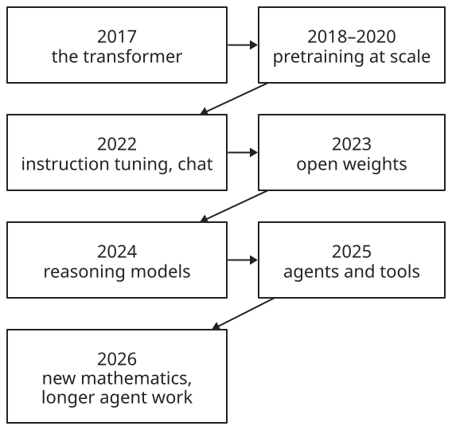

+++
title = 'Large language models'
date = '2026-11-07T23:15:27Z'
+++

A large language model (LLM) is a neural network trained on a very large amount of text to predict the next token, a small piece of text, from the tokens before it. It writes by repeating that one step: predict a token, append it, and predict again. Answering, translating, summarizing, and writing code are all that same step, because each can be posed as text to continue. Before LLMs, each of those tasks usually needed its own program or its own trained model.

## Components

An LLM in use has four parts:

- Tokenizer: splits text into tokens and gives each a number. Common words are one token, and rare words are split into several.
- Model: a transformer, a stack of layers holding millions to trillions of learned numbers, that turns the tokens so far into a probability for every possible next token.
- Generation loop: picks one token from those probabilities, appends it, and runs the model again, until the model produces an end token.
- Application: the chat app or API around the model. It turns a conversation into one sequence of tokens, sends the whole history with each request, and runs any tools the model asks for.

The model's numbers are set by training, in two stages. Pretraining on raw text makes a base model, which continues any text. Post-training on example conversations and feedback turns it into a chat model, which follows instructions and ends its turn.

## Key terms

Text in and out:

- Token: the unit a model reads and writes, often a word or part of a word. Limits and API prices are counted in tokens.
- Prompt: the text given to the model, which it continues.
- Context window: the most tokens a model can take in at once, prompt and reply together.
- Temperature: a setting for how random the choice of each token is. Low values favor the most likely tokens.
- Multimodal: able to take in, or produce, images, audio, or video as well as text. The other media are turned into tokens too.

The model:

- Parameters, or weights: the learned numbers in the model. Their count measures the model's size, such as 124 million for GPT-2 small.
- Transformer: the network design that LLMs use, a stack of layers built around attention.
- Attention: the step in each layer that lets each token draw on the tokens before it.
- Inference: running a trained model to produce output, as opposed to training it.
- Quantization: storing weights with fewer bits, such as 4 instead of 16, so a model takes about a quarter of the memory, usually at a small cost in quality.
- Embedding: a list of numbers that stands for a piece of text, placed so that texts with similar meaning have similar numbers.
- Mixture of experts (MoE): a design in which each token passes through only some of the model's weights, so a model with a trillion parameters uses tens of billions per token.

Training:

- Pretraining: training on a huge amount of text to predict each next token. It's where most of the model's knowledge comes from.
- Base model: the result of pretraining. It continues text but doesn't follow instructions.
- Fine-tuning: further training on a smaller, chosen data set, such as example conversations.
- RLHF: reinforcement learning from human feedback, training toward replies that people rated better.
- Chat model, or instruction-tuned model: a base model after post-training, which answers and then stops.

Using a model:

- System prompt: instructions from the application, placed before the conversation.
- Hallucination: a fluent statement that is false. A model produces likely text and doesn't look facts up.
- Knowledge cutoff: the date the training data ends. The model knows nothing later unless the prompt includes it.
- Prompting: steering a model through what the prompt says, such as instructions and examples. It changes no weights, unlike fine-tuning.
- RAG: retrieval-augmented generation. The application searches documents, often by comparing embeddings, and puts the best matches into the prompt, so the model answers from them.
- Reasoning model: a model trained to work through a long chain of thought before it answers.
- Reasoning tokens: the tokens a reasoning model writes while thinking, before its answer. Spending more of them, called test-time compute, often improves hard answers, and they're usually billed as output tokens.
- Tool use: the model writes a request for a tool, such as a search or a command, and the application runs it and returns the result.
- Agent: a model that works in a loop of tool calls toward a goal, such as editing code until the tests pass.
- Open weights: weights published for anyone to download and run, as with Llama, Qwen, and DeepSeek.

## Ways to use a model

There are three ways to reach a model. A chat app, such as ChatGPT, Claude, or Gemini, is the simplest. A program calls the maker's API over HTTP, sends the conversation as a list of messages, and pays per token in and out. Open weights can also run on one's own machine, where the data never leaves it.

Running locally needs enough memory to hold the weights. At 16 bits, each parameter takes 2 bytes, so a 7-billion-parameter model needs about 14 GB. Quantized to 4 bits, it needs about 4 GB, which fits on a laptop. [Ollama](https://github.com/ollama/ollama) downloads quantized models and runs them with one command:


ollama run | Download the model if it isn't on the machine yet, then start a chat in the terminal. Ollama also serves an HTTP API on the same machine, so programs can use the model.
qwen2.5:0.5b | The model's name in Ollama's library, then a size tag, here 0.5 billion parameters. Without a tag, Ollama uses the model's default size.


[llama.cpp](https://github.com/ggml-org/llama.cpp), a C/C++ engine for running models locally, runs quantized models stored in the GGUF file format.

## Milestones

- 2017, [Transformer](https://arxiv.org/abs/1706.03762) (paper, Google). Attention replaced step-by-step recurrence, so training runs in parallel on whole sequences. The models that followed are built on it.
- 2018, [GPT](https://cdn.openai.com/research-covers/language-unsupervised/language_understanding_paper.pdf) (paper, OpenAI). Pretrain on raw text first, then fine-tune for a task.
- 2018, [BERT](https://arxiv.org/abs/1810.04805) (paper, Google). The same pretraining idea, reading text in both directions. It set records on language-understanding benchmarks.
- 2019, [GPT-2](https://cdn.openai.com/better-language-models/language_models_are_unsupervised_multitask_learners.pdf) (model, OpenAI). 1.5 billion parameters. It began to translate and summarize with no task-specific training.
- 2020, [Scaling laws](https://arxiv.org/abs/2001.08361) (paper, OpenAI). Loss falls predictably as parameters, data, and compute grow, so bigger runs could be planned.
- 2020, [GPT-3](https://arxiv.org/abs/2005.14165) (paper, OpenAI). 175 billion parameters. It learns a task from a few examples in the prompt, called in-context learning.
- 2021, [Codex and GitHub Copilot](https://arxiv.org/abs/2107.03374) (product, OpenAI and GitHub). A GPT model trained on public code, completing code inside the editor.
- 2022, [Chain-of-thought prompting](https://arxiv.org/abs/2201.11903) (paper, Google). Showing step-by-step answers in the prompt improves multi-step reasoning.
- 2022, [InstructGPT](https://arxiv.org/abs/2203.02155) (paper, OpenAI). Fine-tuning and RLHF make models follow instructions.
- 2022, [ChatGPT](https://openai.com/index/chatgpt/) (product, OpenAI). A chat interface to an instruction-tuned model brought LLMs to the general public.
- 2023, [LLaMA](https://arxiv.org/abs/2302.13971) (open model, Meta). Weights released to researchers. The 13-billion-parameter model beat GPT-3 on most benchmarks, and open-weight models spread.
- 2023, [GPT-4](https://arxiv.org/abs/2303.08774) (model, OpenAI). A large multimodal model, taking images as well as text.
- 2024, [Gemini 1.5](https://arxiv.org/abs/2403.05530) (model, Google). A context window of up to a million tokens.
- 2024, [o1](https://arxiv.org/abs/2412.16720) (model, OpenAI). A reasoning model, trained with reinforcement learning to work through a long chain of thought before answering.
- 2024, [Model Context Protocol](https://www.anthropic.com/news/model-context-protocol) (standard, Anthropic). An open standard for connecting models to tools and data.
- 2025, [DeepSeek-R1](https://arxiv.org/abs/2501.12948) (open model, DeepSeek). An open-weight reasoning model whose reasoning came from reinforcement learning.
- 2025, [Claude Code](https://www.anthropic.com/news/claude-3-7-sonnet) (product, Anthropic). An agentic coding tool: the model reads code, runs commands, and edits files in a loop.
- 2026, [Erdős unit distance conjecture disproved](https://openai.com/index/model-disproves-discrete-geometry-conjecture/) (research result, OpenAI). A general-purpose reasoning model found a counterexample to a 1946 conjecture in geometry, and mathematicians checked it and published an explanation of the proof.
- 2026, new frontier generations: [Gemini 3.5](https://blog.google/innovation-and-ai/technology/ai/google-ai-updates-may-2026/) (May, Google), [Claude Opus 5](https://www.anthropic.com/news/claude-opus-5) (July, Anthropic), and [GPT-6](https://openai.com/index/gpt-6-astra/) (September, OpenAI). Each centers on agentic work: coding, using a computer, and long tasks with many steps.

## Model families

Closed models are used only through the maker's apps and API. Open-weight models can be downloaded, run on one's own hardware, and fine-tuned, under each family's license. Most leading Chinese families publish open weights, and many use a mixture-of-experts design.

United States:

- [GPT](https://platform.openai.com/docs/models) (OpenAI, since 2018). The models behind ChatGPT. Weights have been closed since GPT-3, apart from the open-weight [gpt-oss](https://github.com/openai/gpt-oss) models of 2025.
- [Claude](https://www.anthropic.com/claude) (Anthropic, since 2023). Closed models, with the agentic coding tool Claude Code.
- [Gemini](https://deepmind.google/models/gemini/) (Google DeepMind, since 2023). Closed models built to take text, images, audio, and video, with context windows of up to a million tokens or more.
- [Grok](https://x.ai/grok) (xAI, since 2023). Closed models built into X. xAI also published the weights of [Grok-1](https://github.com/xai-org/grok-1).
- [Llama](https://www.llama.com/) (Meta, since 2023). Open weights under Meta's own license, first released to researchers in 2023.
- [Gemma](https://deepmind.google/models/gemma/) (Google DeepMind, since 2024). Small open-weight models built from Gemini research.

China:

- [Qwen](https://github.com/QwenLM) (Alibaba, since 2023). Open-weight models in many sizes, from under a billion parameters up, plus closed flagship models.
- [DeepSeek](https://github.com/deepseek-ai) (DeepSeek, since 2023). Open weights, most recently under the MIT license. DeepSeek-V3 has 671 billion parameters, 37 billion active per token, and DeepSeek-R1 brought reasoning to open weights in 2025.
- [Kimi](https://github.com/MoonshotAI) (Moonshot AI, since 2023). Kimi K2, from 2025, has 1 trillion parameters, 32 billion active, with open weights.
- [GLM](https://github.com/zai-org) (Zhipu AI, also called Z.ai, since 2022). Open weights. GLM-4.5 has 355 billion parameters, 32 billion active, under the MIT license.
- [MiniMax](https://github.com/MiniMax-AI) (MiniMax, open weights since 2025). MiniMax-01 has 456 billion parameters and handles contexts of up to 4 million tokens.
- [ERNIE](https://github.com/PaddlePaddle/ERNIE) (Baidu, since 2023). Closed at first, with ERNIE 4.5 released under the Apache 2.0 license in 2025.

Europe:

- [Mistral](https://mistral.ai/models) (Mistral AI, France, since 2023). Mistral 7B, its first model, was released under the Apache 2.0 license, and it publishes both open-weight and closed models.

## How models changed

Three things changed at once: models grew, their context windows grew, and the largest open models switched to mixture of experts.

![A chart of published parameter counts by year, on a log scale. GPT-1 in 2018 had about 117 million, GPT-2 in 2019 1.5 billion, GPT-3 in 2020 175 billion, LLaMA in 2023 65 billion, and Llama 3.1 in 2024 405 billion. From late 2024, the largest open models use mixture of experts, drawn as a filled dot for total parameters joined to a hollow dot for parameters used per token: DeepSeek-V3, 671 billion total and 37 billion per token; Kimi K2, 1 trillion and 32 billion; DeepSeek-V4-Pro, 1.6 trillion and 49 billion; and Kimi K3, 2.8 trillion and 104 billion.](params.svg)

Up to GPT-3, models were dense: every token uses every weight. Since GPT-4 in 2023, the makers of GPT, Claude, and Gemini haven't published parameter counts, so the chart shows only models whose makers did. Open models then went the other way: LLaMA's 13-billion-parameter version beat the 175-billion-parameter GPT-3 on most benchmarks, by training a smaller model on more tokens. From late 2024, the largest open models are mixtures of experts. Their total size passed a trillion parameters, while the part used for each token stayed between about 30 and 100 billion, so each token takes about the computation of a dense model that size.

Context windows grew about a thousandfold in six years, from 512 tokens, about a page, to a million tokens, several long books or a large codebase. A window states how much a model can take in. How well it uses the far end of a long window is measured separately, and varies by model.

The price of using a model fell as well. These are OpenAI's prices at launch, per million input tokens:

| Model, launch | Price per million input tokens |
|---|---|
| GPT-3.5 (text-davinci-003), Nov 2022 | $20 |
| GPT-4, Mar 2023 | $30 |
| GPT-3.5 Turbo, Mar 2023 | $2 |
| GPT-4o, May 2024 | $5 |
| GPT-4o mini, Jul 2024 | $0.15 |

GPT-4o mini scored 82% on MMLU, a general-knowledge benchmark, against GPT-3.5 Turbo's 69.8%, at under a tenth of its price. In under two years, the price of GPT-3.5-level text fell more than a hundredfold.

## Open-weight flagships compared

Open-weight makers publish their models' sizes and context windows, so they can be compared directly. Figures are from each model's card:

| Model, release | Parameters, total / per token | Context | License |
|---|---|---|---|
| Llama 3.1 405B (Meta), Jul 2024 | 405B / 405B, dense | 128K | Llama 3.1 Community |
| DeepSeek-V3, Dec 2024 | 671B / 37B | 128K | DeepSeek Model License |
| Qwen3-235B-A22B (Alibaba), Apr 2025 | 235B / 22B | 32K, 131K extended | Apache 2.0 |
| Kimi K2 (Moonshot AI), Jul 2025 | 1T / 32B | 128K | Modified MIT |
| GLM-4.5 (Zhipu AI), Jul 2025 | 355B / 32B | 128K | MIT |
| GLM-5 (Zhipu AI), Feb 2026 | 744B / 40B | about 200K | MIT |
| DeepSeek-V4-Pro, Apr 2026 | 1.6T / 49B | 1M | MIT |
| Kimi K3 (Moonshot AI), Jul 2026 | 2.8T / 104B | 1M | Kimi K3 License |
| Qwen3.8-2.4T-A95B (Alibaba), Aug 2026 | 2.4T / 95B | 262K, 1M extended | Qwen's own license |

Since 2025, every model in this table has come from a Chinese lab. Closed models don't publish these figures, and makers report benchmark scores from their own test setups, so scores from different makers aren't directly comparable.

## How models are evaluated

A benchmark is a fixed set of tasks with known answers, scored automatically. A few appear in most announcements:

| Benchmark | What it measures |
|---|---|
| [MMLU](https://arxiv.org/abs/2009.03300) (2020) | Knowledge across 57 subjects, from elementary math to law, as multiple-choice questions. |
| [HumanEval](https://arxiv.org/abs/2107.03374) (2021) | Writing 164 small Python functions, checked by unit tests. |
| [GPQA](https://arxiv.org/abs/2311.12022) (2023) | 448 graduate-level questions in biology, physics, and chemistry, written so that searching the web doesn't help. |
| [SWE-bench](https://arxiv.org/abs/2310.06770) (2023) | Fixing 2,294 real issues from 12 Python projects on GitHub, checked by the projects' own tests. |
| [Humanity's Last Exam](https://arxiv.org/abs/2501.14249) (2025) | 2,500 hard questions from experts in dozens of subjects. |
| [LMArena](https://arxiv.org/abs/2403.04132) (2023) | Which of two anonymous models' replies people prefer, from crowdsourced votes, turned into a ranking. |

Benchmarks saturate: once the best models score near the top, a benchmark stops telling them apart, so new, harder ones keep appearing. Questions can also leak into training data, which inflates scores. Some newer benchmarks keep part of their questions private, or use problems written after the models were trained.

References: [Attention Is All You Need](https://arxiv.org/abs/1706.03762), [GPT-2 paper](https://cdn.openai.com/better-language-models/language_models_are_unsupervised_multitask_learners.pdf), [GPT-3 paper](https://arxiv.org/abs/2005.14165), [InstructGPT](https://arxiv.org/abs/2203.02155), [LLaMA](https://arxiv.org/abs/2302.13971), [GPT-4 announcement](https://openai.com/index/gpt-4-research/), [Introducing ChatGPT and Whisper APIs](https://openai.com/index/introducing-chatgpt-and-whisper-apis/), [GPT-4o](https://openai.com/index/hello-gpt-4o/), [GPT-4o mini](https://openai.com/index/gpt-4o-mini-advancing-cost-efficient-intelligence/), [Claude 100K context](https://www.anthropic.com/news/100k-context-windows), [Gemini 1.5](https://arxiv.org/abs/2403.05530), [MiniMax-01](https://arxiv.org/abs/2501.08313), [DeepSeek-V3](https://arxiv.org/abs/2412.19437), [Qwen2.5 Technical Report](https://arxiv.org/abs/2412.15115), [Llama 3.1 405B card](https://huggingface.co/meta-llama/Llama-3.1-405B), [Qwen3-235B-A22B card](https://huggingface.co/Qwen/Qwen3-235B-A22B), [Kimi K2 card](https://huggingface.co/moonshotai/Kimi-K2-Instruct), [GLM-4.5 card](https://huggingface.co/zai-org/GLM-4.5), [GLM-5 card](https://huggingface.co/zai-org/GLM-5), [DeepSeek-V4-Pro card](https://huggingface.co/deepseek-ai/DeepSeek-V4-Pro), [Kimi K3 card](https://huggingface.co/moonshotai/Kimi-K3), [Qwen3.8-2.4T-A95B card](https://huggingface.co/Qwen/Qwen3.8-2.4T-A95B), [Hugging Face chat templates](https://huggingface.co/docs/transformers/main/en/chat_templating)
