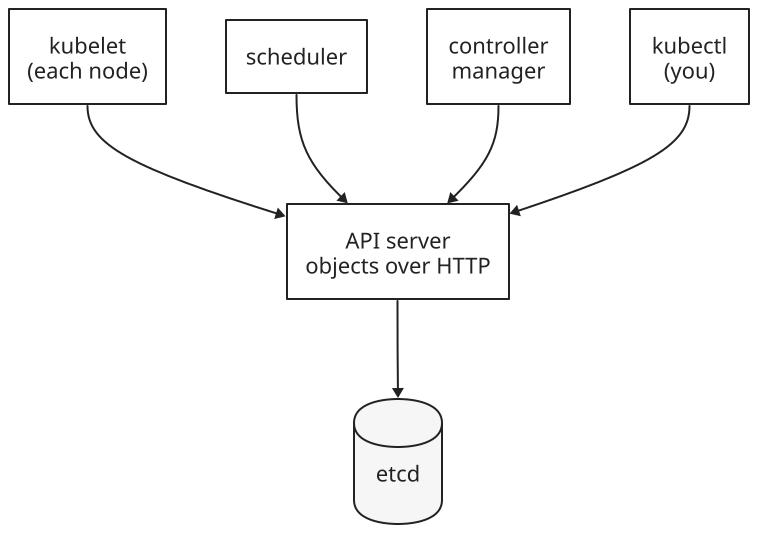
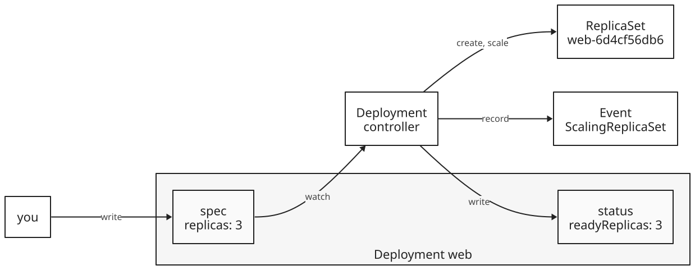
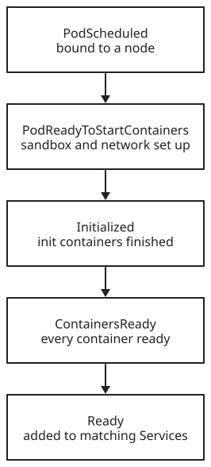
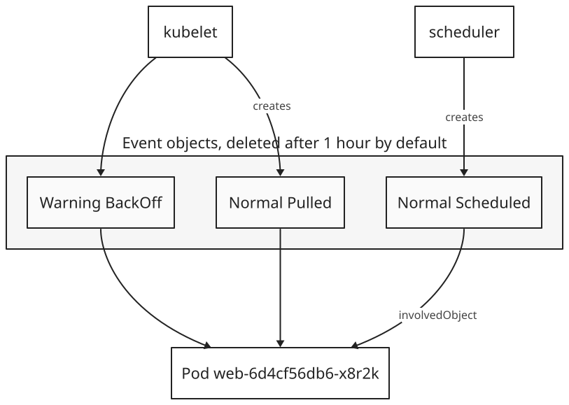

+++
title = 'The Kubernetes API'
date = '2026-11-07T20:47:34Z'
+++

The Kubernetes API is the HTTP interface through which everything reads and changes a cluster. Every part of the cluster is described by an object stored behind it: each Deployment, pod, Service, and node. Every component reads and changes cluster state only through it. kubectl, the , the , and the  are all clients of the , which stores the objects in . One shared store of objects lets each component work alone: it reads the objects it cares about, does its job, and writes the result back.

The API has a few parts:

- Resources: URLs that name one object or a collection of objects.
- Objects: records in a fixed shape, with metadata, a spec, and a status.
- The spec: the state you want, which you write.
- The status: the state that is, which a controller writes.
- Events: separate objects that record what controllers did and why.



## Resources and URLs

The API is a REST API. Each object type is a resource with its own URL, and HTTP methods act on it: GET reads, POST creates, PUT replaces, PATCH changes some fields, and DELETE removes. A GET on a collection is called a list. A GET with `?watch` is called a watch and keeps the connection open, streaming each change as it happens.

The URL of the Deployment `web` names everything needed to find it:


/apis | Named API groups. The oldest types, such as pods, Services, and nodes, form the core group, which lives under `/api` and has no group segment.
apps | The API group, a family of related types. Deployments and ReplicaSets are in `apps`.
v1 | The version of the group's schema. A type can be served in more than one version at once.
namespaces/default | The namespace. Cluster-wide types, such as nodes, have no namespace segment.
deployments | The resource, the plural name of the type.
web | The object's name. Without it, the URL is the collection of all Deployments in the namespace.


The pod `web-6d4cf56db6-x8r2k` is in the core group, so its URL is `/api/v1/namespaces/default/pods/web-6d4cf56db6-x8r2k`.

## Resources and objects

A resource and an object aren't the same thing. One object can be reached through several resources: the Deployment `web` appears in the list at `…/deployments` and alone at `…/deployments/web`. Some objects have subresources, such as `…/deployments/web/status`, which reads and writes only the status part, and `…/deployments/web/scale`, which reads and writes only the replica count. Some resources store nothing: a POST to `subjectaccessreviews` asks whether a user may perform an action, and the answer comes back without any object being created.


## Talking to the API directly

kubectl turns each command into HTTP requests. The API server serves only TLS and checks who each client is, and kubectl handles both with the server address and credentials in its . Three commands show the HTTP underneath.

To send a GET to any URL and print the JSON the API server returns:


kubectl get --raw | Send a GET to the path that follows, with kubectl's credentials, and print the response body as is.
/apis/apps/v1/namespaces/default/deployments/web | The path, as in the previous section.


To reach the API with plain HTTP tools such as `curl`, start a local proxy that adds the credentials:


kubectl proxy | Listen on the local machine and forward each request to the API server with kubectl's credentials.
+ --port=8001 | The local port. Requests go to `http://127.0.0.1:8001` followed by an API path.


To see which requests an ordinary command sends:


kubectl get deployment web | Read one Deployment.
-v=6 | Log each request's method, URL, and response code. Level 7 adds the request headers, and level 8 the request and response bodies.


The responses are JSON by default. A client can ask for YAML instead, or for Protobuf, a binary format that the built-in components use for speed. kubectl converts a YAML manifest to JSON before sending it.

## Four parts of every object

Every object has the same outline. Type metadata, `apiVersion` and `kind`, says which schema the rest follows. Object metadata, under `metadata`, holds the name and the other fields that identify the object, and its fields are the same for every kind. The spec holds the desired state, and the status holds the actual state. Their fields differ for each kind.


A GET returns the whole object, all four parts. Not every kind has a spec and a status: objects that only hold data, such as ConfigMaps and Events, have neither, because there is no desired state to reach.

## Spec, status, and controllers

The spec and the status are written by different parties. You write the spec. A controller watches objects of its kind, compares each spec with the real state of the cluster, and acts to close the gap. Then it writes what it observed into the status. It also records what it did as Event objects. Most kinds have one controller that owns them. The Deployment controller, for example, owns Deployments.



The loop never ends. If a pod dies, the status falls short of the spec again, and the controllers act again. Writing the spec states a result, not the steps to reach it.

## A manifest, part by part

This command prints the whole Deployment `web`:


kubectl get deployment web | Read the Deployment named `web`.
-o yaml | Print the full object as YAML. `-o json` prints JSON, the form the API server sent. Without `-o`, kubectl prints a one-line summary.
+ --namespace=default | The namespace of the current kubeconfig context.


Trimmed, with comments added, it looks like this:

```yaml
apiVersion: apps/v1               # type metadata
kind: Deployment
metadata:                         # object metadata
  name: web
  namespace: default
  uid: 3f6c1d2e-…                 # set by the API server
  resourceVersion: "4822"         # changes on every write
  generation: 2                   # changes when the spec changes
  creationTimestamp: "2026-11-07T20:50:12Z"
  labels:
    app: web
spec:                             # written by you
  replicas: 3
  selector:
    matchLabels:
      app: web
  template: …                     # the pod template
status:                           # written by the Deployment controller
  observedGeneration: 2
  replicas: 3
  readyReplicas: 3
  availableReplicas: 3
  conditions: …
```

The API server fills in many fields that the original manifest left out: the uid, the timestamps, the defaults in the spec, and the whole status.

## Object metadata

The metadata fields are the same in every kind. Some are set by you, and some only by the system.

| Field | Meaning |
|---|---|
| `name` | Unique among objects of one kind in one namespace. Can't change. |
| `namespace` | The namespace the object lives in. Can't change. |
| `uid` | Unique across the cluster's whole history. Set by the API server. |
| `labels` | Key-value pairs that selectors match, as a Service's selector does. |
| `annotations` | Key-value pairs for tools. Selectors can't match them. |
| `ownerReferences` | The objects this one belongs to. A pod lists its ReplicaSet. When all owners are deleted, the object is garbage collected. |
| `resourceVersion` | The version of this copy of the object. Set by the API server. |
| `generation` | A counter of changes to the spec. Set by the API server. |
| `finalizers` | Work that must finish before the object is deleted. |

`selfLink` appears in older output and in old books. The API server no longer fills it in.

## Versions and conflicts

Every write gives the object a new `resourceVersion`. A client that updates an object sends back the `resourceVersion` it read. If the object changed in between, the API server rejects the update with 409 Conflict, and the client reads the object again and retries. No change is lost silently, even with many writers.

Controllers use the same numbers to stay current without polling. A controller lists the objects once, then watches from the `resourceVersion` the list returned, and the API server streams every later change. The API server keeps about five minutes of history for this. A watch that starts from an older version fails with 410 Gone, and the controller lists again.

![A sequence diagram with three participants: a client, the API server, and the Deployment controller. The controller lists Deployments and gets web at resourceVersion 4810, then watches from 4810. The client updates the spec to replicas 3, sending resourceVersion 4810. The API server stores it as resourceVersion 4822, generation 2, and sends the change to the controller, drawn dashed, as MODIFIED web. The controller updates …/web/status with observedGeneration 2, which the API server stores as resourceVersion 4830. The client then sends an update from its old copy, at resourceVersion 4822, and the API server answers 409 Conflict.](versions.svg)

`generation` and `observedGeneration` show whether a controller has caught up. The API server raises `generation` when the spec changes. The controller copies the generation it last acted on into `status.observedGeneration`. While the two differ, the status describes an older spec.

## Looking up fields

The API describes its own types. kubectl reads that description to explain any field:


kubectl explain | Print the documentation for a type or a field, from the schema the API server publishes.
deployment.spec.replicas | A dot path from the type down to the field. `deployment` alone describes the type and lists its top-level fields.
+ --recursive=false | With `--recursive`, list every nested field name, without descriptions.


To list every type the cluster serves, with its short name, API group, and whether it's namespaced:


kubectl api-resources | List every resource type the API server serves.


## Status conditions

Many kinds report their status as a list of conditions instead of one state field. Each condition covers one aspect of the object and has a `type`, a `status` of `True`, `False`, or `Unknown`, a `reason` for programs, a `message` for people, and a `lastTransitionTime`. A list can gain new types without breaking clients that read only the ones they know.

A pod's conditions become `True` roughly in order as it starts:



The last one, `Ready`, decides whether the pod receives connections from a [Service](). A Deployment has the conditions `Available` and `Progressing`. A node's conditions include `Ready`, `MemoryPressure`, `DiskPressure`, and `PIDPressure`, which turn `True` when the node runs low on memory, disk, or process IDs.

## kubectl describe

`kubectl describe` prints an object in readable form, and adds information that isn't in the object itself:


kubectl describe | Print one or more objects in readable form, with related objects and recent events.
pod web-6d4cf56db6-x8r2k | The kind and the name. Without a name, it describes every object of that kind in the namespace.


kubectl assembles the result from several requests. For a node, it lists the pods running there by querying the pods resource. For any object, it lists the Events about it. None of this is stored in the object, and `kubectl get -o yaml` doesn't show it.

## Events

Controllers and the kubelet report what they do by creating Event objects. Each Event points to the object it's about, in its `involvedObject` field, and has a type, `Normal` or `Warning`, a `reason`, a `message`, the component that reported it, and a count of how often it repeated. Events are separate objects, so they don't make the object they describe any larger. The API server keeps Events for one hour by default, a limit set by its `--event-ttl` flag, so they show only recent history.



To list the events for one pod and keep printing new ones:


kubectl events | List recent events in the namespace.
--for pod/web-6d4cf56db6-x8r2k | Only events about this object. Without it, every event in the namespace.
--types=Warning | Only Warning events. Without it, both types.
--watch | Keep running and print new events as they arrive.


A pod's normal start leaves Scheduled from the scheduler, then Pulling, Pulled, Created, and Started from the kubelet. Warnings point to what went wrong. FailedScheduling means no node fits the pod, and BackOff means a container keeps exiting and the kubelet is waiting longer between restarts.

## Objects without a spec and status

An Event is one of the kinds with no spec or status. Its fields sit at the top level, and kubectl prints fields in alphabetical order, so `kind` and `metadata` end up in the middle:

```yaml
apiVersion: v1
eventTime: "2026-11-07T20:50:14.120934Z"
involvedObject:
  kind: Pod
  name: web-6d4cf56db6-x8r2k
  namespace: default
kind: Event
message: Successfully assigned default/web-6d4cf56db6-x8r2k to node-1
metadata:
  name: web-6d4cf56db6-x8r2k.18a5c3f2b1e0d4a7
  namespace: default
reason: Scheduled
reportingComponent: default-scheduler
type: Normal
```

This is the `v1` Event. A newer version, in the `events.k8s.io` group, serves the same stored events with renamed fields: `regarding` for `involvedObject`, and `note` for `message`. It's another case of one object reached through two resources.

References: [Kubernetes API concepts](https://kubernetes.io/docs/reference/using-api/api-concepts/), [Objects in Kubernetes](https://kubernetes.io/docs/concepts/overview/working-with-objects/), [ObjectMeta](https://kubernetes.io/docs/reference/kubernetes-api/common-definitions/object-meta/), [Controllers](https://kubernetes.io/docs/concepts/architecture/controller/), [Pod conditions](https://kubernetes.io/docs/concepts/workloads/pods/pod-lifecycle/#pod-conditions), [Event](https://kubernetes.io/docs/reference/kubernetes-api/cluster-resources/event-v1/), [kube-apiserver](https://kubernetes.io/docs/reference/command-line-tools-reference/kube-apiserver/), [kubectl quick reference](https://kubernetes.io/docs/reference/kubectl/quick-reference/), [kubectl events](https://kubernetes.io/docs/reference/kubectl/generated/kubectl_events/)
