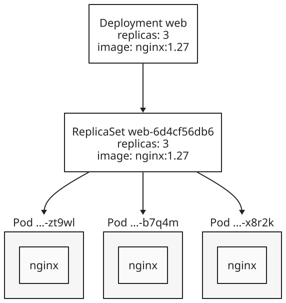
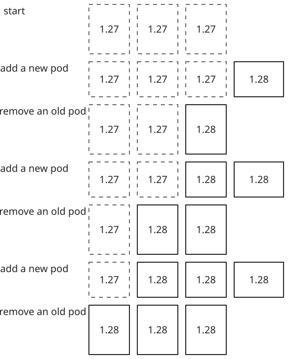
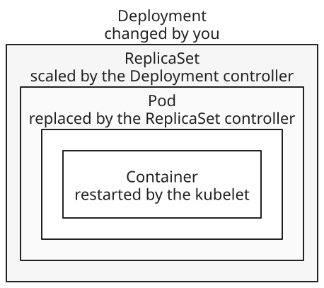

+++
title = 'From containers to Deployments'
date = '2026-11-03T17:09:52Z'
+++

A Deployment is the object you usually create to run an application on Kubernetes: you give it a  and a number of copies, and Kubernetes keeps that many running and updates them in a controlled way. It doesn't run containers directly. It sits on three layers: a pod wraps containers, a ReplicaSet keeps a number of identical pods running, and the Deployment moves them from one version to the next. Each layer solves a problem the layer below it can't, and one component watches each layer to keep it as you asked.

## Container to pod

A container is a process that [namespaces]() isolate and [cgroups]() limit. Kubernetes never runs a container on its own. Its smallest unit is the pod: one or more containers that always run together on one . The  assigns a node to a pod, not to a container, so all of a pod's containers run on the same node.

The containers in a pod share a network namespace. They have one IP address and one set of ports, and they reach each other on localhost. They can also share storage . Before starting any container, the  has the  set up this shared context, called the pod sandbox, and then starts each container inside it. Most pods hold one container. A second container belongs in the same pod only when it must share the first one's network or files, such as a helper that downloads the files a web server serves.

A pod stays on its node for its whole life. If a container exits, the kubelet restarts it inside the same pod, because a pod's restart policy is Always by default. That's as far as a pod can repair itself. If the pod is deleted or its node fails, the pod is gone, and Kubernetes never moves a pod to another node. A replacement has to be a new pod, with a new name and a new IP address, and something outside the pod has to create it.

## Pod to ReplicaSet

That something is a ReplicaSet, which keeps a set number of identical pods running. It holds three things: a pod template, which describes the pods to create; a replica count; and a  selector, which says which pods count as its own. The ReplicaSet , in the , compares the number of matching pods with the replica count. If there are too few, it creates pods from the template. If there are too many, it deletes some. So a deleted pod or a failed node ends with a new pod, possibly on another node.

A ReplicaSet only counts pods, though. It doesn't update the pods it already has. If you change its template, existing pods keep running the old version, and only pods it creates later use the new one. Moving every pod to a new image, without stopping them all at once, needs one more layer.

## ReplicaSet to Deployment

A Deployment owns one ReplicaSet for each version of its pod template. When you change the template, for example to a new image, the Deployment controller creates a new ReplicaSet and scales it up while it scales the old one down. This is a rolling update. By default, it keeps at least 75% of the desired pods available and runs at most 125% of them. The old ReplicaSet stays, scaled to zero, so you can roll back. A Deployment keeps 10 old ReplicaSets by default. Changing only the replica count updates the current ReplicaSet and creates no new one.

You create and change Deployments, and the Deployment manages its ReplicaSets for you. The names show the chain. Each ReplicaSet is named after its Deployment plus a hash of its pod template, and each pod is named after its ReplicaSet plus five random characters. So a pod's name tells you which Deployment it belongs to and which version of the template it runs.

## Creating a Deployment

With the layers in mind, here is what one  command sets off. Point at a part to see what it does. Show defaults to see the parts you can leave out.


kubectl | The command-line client. It turns the command into a request to the API server.
create deployment | Create an object of type Deployment, built from the flags that follow.
web | The Deployment's name. Its ReplicaSets and pods are named after it, and kubectl gives its pods the label `app=web`, which the Deployment selects them by.
--image=nginx:1.27 | The image for the pod's one container. With no registry, the image comes from Docker Hub, so this is `docker.io/library/nginx:1.27`. With no tag, it would be `nginx:latest`. kubectl names the container after the image, here `nginx`.
+ --replicas=1 | How many pods to run.
+ --namespace=default | The namespace to create the Deployment in. Without this flag, kubectl uses the namespace of the current kubeconfig context, which is `default` unless the context sets another.


kubectl sends the Deployment to the , which stores it in . kubectl's part ends there. Every later step happens because a component watches the API server for one kind of object, does its own job, and writes the result back. The Deployment controller sees the new Deployment and creates a ReplicaSet from its template. The ReplicaSet controller sees the ReplicaSet with no matching pods and creates one. The scheduler sees a pod with no node, picks a node for it, and records that choice, which is called binding. The kubelet on that node sees the pod bound to it, has the container runtime pull the image and start the container, and reports the pod's status. The layers are built from the top down, one controller at a time.

The same steps in time order are shown below as messages between components. Solid arrows are requests to the API server. Dashed arrows are changes the API server sends to a component that watches for them.

![A sequence diagram with five participants: kubectl, the API server, the controller manager, the scheduler, and the kubelet. kubectl asks the API server to create a Deployment. The API server notifies the controller manager of the Deployment, and the controller manager asks it to create a ReplicaSet. The API server notifies the controller manager of the ReplicaSet, and the controller manager asks it to create pods. The API server notifies the scheduler of pods with no node, and the scheduler asks it to bind the pods. The API server notifies the kubelet of a pod on its node. The kubelet starts the containers and reports to the API server that the pod is Running. Solid arrows are requests to the API server; dashed arrows are changes the API server sends to components that watch for them.](sequence.svg)

You can see the same chain on a real pod. The events at the end of `kubectl describe pod` list Scheduled, from the scheduler, then Pulling, Pulled, Created, and Started, from the kubelet. To list the pods and the nodes they landed on, add wide output to `kubectl get`:


kubectl get | List objects of one type in a table.
pods | The type to list. `pod` and the short name `po` work too.
-o wide | Add columns, including each pod's IP address and node. Without it, kubectl prints a shorter table.
+ --namespace=default | As before, the namespace of the current context.


The pod's name has three parts:


web | The Deployment's name.
6d4cf56db6 | The pod template hash. It's the same in the ReplicaSet's name, and it changes when the template changes.
x8r2k | Five random characters, so that each pod's name is unique.


## Changing it

Each change below is made at one layer, and the controllers below it do the rest. To run three pods instead of one, change the replica count on the Deployment:


kubectl scale | Change how many pods an object runs.
deployment web | The object to scale. `deployment/web` means the same.
--replicas=3 | The new desired count.


This only changes a number stored in the Deployment. The Deployment controller copies the new count to its ReplicaSet, and the ReplicaSet controller creates two more pods. You state the result you want, not the steps to get there. If you then delete a pod with `kubectl delete pod`, the ReplicaSet controller sees two pods where it wants three and creates a new one, with a new random suffix and a new IP address.

To update the pods, change the pod template, for example the image:


kubectl set image | Change the image of one or more containers in an object's pod template.
deployment/web | The object to change.
nginx=nginx:1.28 | The container name, then its new image. The container is named `nginx` because `kubectl create deployment` named it after its image.


The template changed, so the Deployment controller creates a second ReplicaSet with a new hash in its name. With three replicas, the defaults round to at most one extra pod and none unavailable. So the Deployment starts one new pod, waits until it's available, deletes one old pod, and repeats until all three run nginx 1.28. In the diagram below, each row is one step, and old pods have dashed borders. The old ReplicaSet is left with zero pods, and `kubectl rollout undo deployment/web` scales it back up.

## The layers together

Each layer owns the one inside it, and one component acts on each:

One thing none of these layers gives is a stable address. Every replacement pod gets a new IP address, so clients can't rely on any one pod's address. A [Service]() fills that gap: it gives a set of pods one address that stays the same while the pods behind it change.

References: [Pods](https://kubernetes.io/docs/concepts/workloads/pods/), [Pod lifecycle](https://kubernetes.io/docs/concepts/workloads/pods/pod-lifecycle/), [ReplicaSet](https://kubernetes.io/docs/concepts/workloads/controllers/replicaset/), [Deployments](https://kubernetes.io/docs/concepts/workloads/controllers/deployment/), [kubectl create deployment](https://kubernetes.io/docs/reference/kubectl/generated/kubectl_create/kubectl_create_deployment/), [kube-scheduler](https://kubernetes.io/docs/concepts/scheduling-eviction/kube-scheduler/), [Images](https://kubernetes.io/docs/concepts/containers/images/)
