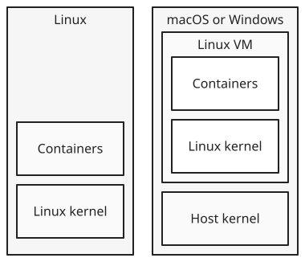
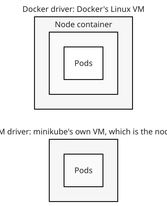

+++
title = 'Local Kubernetes clusters'
date = '2026-11-01T18:49:39Z'
+++

A local Kubernetes cluster is a cluster whose control plane and nodes all run on one computer, such as a laptop, for learning and development.

The [architecture]() assumes several Linux machines: some for the control plane and one for each node. A laptop is one machine, so local tools make stand-ins. A stand-in node is either a virtual machine, which simulates a whole computer with its own kernel, or a container, which is only a group of processes isolated by [namespaces](). Containers start faster and use less memory, so most tools prefer them.

Where those containers run depends on your operating system. Containers share the kernel they run on, and Kubernetes nodes need a Linux kernel. On Linux, your own kernel is one, so node containers run directly on your computer. macOS and Windows have different kernels, so a Linux virtual machine sits in between, usually the one Docker Desktop starts, and every container runs inside it. Everything above that layer works the same.

Three tools are common, and they differ in what they use as a node:

| Tool | A node is | Nodes |
|---|---|---|
| kind | a container | one or more |
| minikube | a container or a virtual machine, depending on the driver | one, or more if you ask |
| Docker Desktop | a container in Docker Desktop's Linux VM | one (kubeadm) or more (kind) |

kind (Kubernetes in Docker) needs Docker or a similar tool, so on a Mac its node containers run in Docker Desktop's VM. minikube's driver decides the node: with the Docker driver, the node is a container like kind's; with a VM driver, minikube starts its own VM, and that VM is the node. Docker Desktop's built-in cluster always runs inside its VM, even on Linux, where Docker Desktop also uses one. It sets up one node with , or several with kind. Each tool also configures  to talk to the new cluster's API server.

Under the hood, kind, minikube by default, and Docker Desktop's one-node cluster all build the cluster with kubeadm. kubeadm expects a machine that already runs a kubelet and a container runtime. It creates the certificates the components use to trust each other, then writes a manifest file for each control plane component: the API server, etcd, the scheduler, and the controller manager. The kubelet runs these as , which it starts straight from files on disk without asking the API server. That's how the API server can run as a pod before any API server exists. On each other node, kubeadm joins the node to the cluster.

A node container works like a real node. Inside it run a  and a , and the control plane node also runs the control plane components. When a  is assigned to a node, the runtime inside that node container starts the pod's containers. That sounds like containers inside a container, but a container is only processes in namespaces. The runtime asks the same kernel for new namespaces and cgroups, so the pod's processes run on that kernel next to everything else, isolated in their own namespaces.

kubectl finds a cluster through a  file, `$HOME/.kube/config` by default. The file lists clusters, each an API server address and the certificate to trust; users, each a set of credentials; and contexts, each pairing a cluster with a user and a default . kubectl talks to the cluster in the current context. Each local tool adds a context for its cluster and makes it current: `kind-kind` for kind's default cluster, `minikube`, or `docker-desktop`. Moving between clusters means switching contexts.

For example, suppose you use kind on a Mac to create a cluster with one control plane node and two worker nodes, and then run two nginx pods. Docker Desktop's Linux VM now runs three containers: kind-control-plane, kind-worker, and kind-worker2. The scheduler places the pods on the worker nodes, for example one on each. kubectl on your Mac reaches the API server through a port that kind publishes on localhost. On Linux, the same three containers would run directly on your computer's kernel, with no VM.

All nodes share one computer's CPU, memory, and kernel, so a local cluster can't faithfully reproduce real hardware or network failures. It's for learning Kubernetes and building apps, not for testing how a cluster survives a failure.

References: [kind](https://kind.sigs.k8s.io/), [minikube drivers](https://minikube.sigs.k8s.io/docs/drivers/), [Docker Desktop Kubernetes](https://docs.docker.com/desktop/features/kubernetes/), [Docker Desktop on Linux](https://docs.docker.com/desktop/setup/install/linux/), [Kubernetes install tools](https://kubernetes.io/docs/tasks/tools/)
