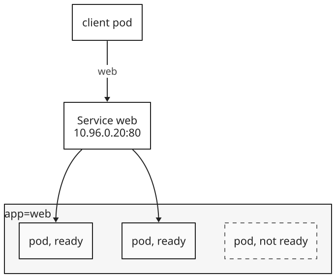
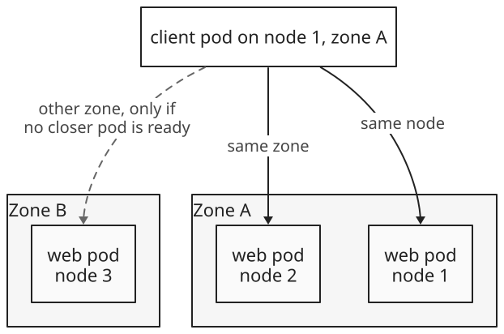
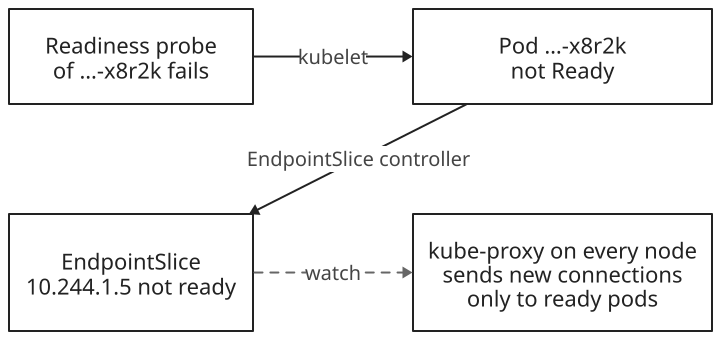

+++
title = 'Services'
date = '2026-11-03T21:30:00Z'
+++

A Service gives a changing set of pods one stable name and IP address, and spreads connections across them. Pods already reach each other directly: each has its own IP address on one flat network, and packets between pods aren't translated, whichever nodes they run on. But a pod's address lasts only as long as the pod, and a [Deployment]() replaces failed pods with new ones at new addresses. A Service puts one fixed address in front of all the replicas, so clients don't track pod addresses.

A Service has three parts:

- A name, such as `web`, that the cluster's DNS turns into an address.
- A fixed address, the cluster IP, which no machine owns. Each node's kernel forwards it.
- A set of pods: the ones whose  matches the Service's selector and that are ready. Each connection goes to one of them.



## Selecting pods

A Service selects pods by label, the same way a ReplicaSet does. A pod belongs to the Service when its labels include every label in the selector; its other labels don't matter. Only pods in the Service's namespace can match. A pod that matches but isn't ready stays out of the set until it is.

## The objects of one application

An application on Kubernetes is a few objects in the API. A Deployment owns a ReplicaSet, and the ReplicaSet owns the pods. Each pod has its own IP address and, here, runs one container. A Service gives the pods one cluster IP address. The Deployment and the Service don't refer to each other. The only link between them is the label `app=web`, which the Deployment puts on every pod it creates and the Service selects. The ReplicaSet also adds a `pod-template-hash` label to its pods, but the Service's selector leaves it out, so during a rolling update the Service sends connections to old and new pods alike.


Solid arrows show ownership, which the pods record in their metadata. Dashed arrows show selection, which the EndpointSlice controller recomputes from labels as pods come and go.

## Ports

Each port of a Service has a number clients connect to, `port`, and the number on the pods it forwards to, `targetPort`, which defaults to the same value. The target port can also name a port from the pod template, so pods with different port numbers can sit behind one Service port. A Service with more than one port must name each one. The protocol is TCP by default; UDP and SCTP also work.

## Creating a Service

This is the Service for the Deployment `web`:

```yaml
apiVersion: v1
kind: Service
metadata:
  name: web
spec:
  type: ClusterIP      # the default
  selector:
    app: web
  ports:
  - port: 80
    targetPort: 80     # the default, same as port
    protocol: TCP      # the default
```

`kubectl expose` creates the same object from an existing one, copying its selector:


kubectl expose | Create a Service for an existing object.
deployment web | The object whose selector the Service copies, here `app=web`.
--port=80 | The Service's port. kubectl copies it from the pod template when there is one, but `kubectl create deployment` sets no port there.
+ --target-port=80 | The port on the pods. Without it, it's the same as `--port`.
+ --name=web | The Service's name. Without it, the Service takes the Deployment's name.
+ --type=ClusterIP | Reachable only from inside the cluster.
+ --protocol=TCP | UDP and SCTP also work.


The  gives the Service its cluster IP from a range set aside for Services. The address stays the same for the Service's whole life, even when its selector or ports change.

## Finding a Service by name

The cluster runs a DNS server, , that every pod uses by default. It answers a Service's full name with the cluster IP. The  sets up each pod's DNS settings with search domains, so a pod can leave out the end of the name:


web | The Service's name.
+ default | Its namespace. A pod in the same namespace can leave it out; one in another namespace writes `web.default`.
+ svc | Marks the name as a Service.
+ cluster.local | The cluster's domain, `cluster.local` unless the cluster sets another.


## Environment variables

The kubelet also writes each Service's address into the environment of new pods, as variables such as `WEB_SERVICE_HOST` and `WEB_SERVICE_PORT`. Only Services that exist when a pod starts are included. A namespace with very many Services can make the environment too large for the container to start, and `enableServiceLinks: false` on the pod turns the variables off. DNS has neither limit, so clients normally use it.

## The components behind it

Three components turn the Service into forwarding:

| Component | Watches, then does |
| --- | --- |
| EndpointSlice  | Watches Services and pods. Lists the IP addresses and ports of the matching pods in an EndpointSlice, each marked ready or not. |
| , on every  | Watches Services and EndpointSlices. Writes rules into the node's kernel that send traffic for the cluster IP to a ready pod. |
| Cluster DNS | Watches Services and EndpointSlices. Answers lookups of the Service's name. |


No single process sits between client and pod. Each component keeps one list up to date, and the kernel on the client's own node does the forwarding. kube-proxy only writes the rules; in its default mode it carries no traffic, so connections keep working if it stops, and only changes to the rules stop.

## One connection

A pod runs `curl http://web`:


The cluster IP answers only on the Service's ports, because it exists only in these rules. Nothing answers `ping` on it, so even a working Service doesn't reply.

## Load balancing per connection

The kernel picks a pod at random for each new connection and keeps that choice until the connection ends. kube-proxy works with TCP and UDP and doesn't understand HTTP, so it can't spread single requests. A client that keeps one connection open, as HTTP/2 and gRPC clients do, sends all its requests to one pod.

`sessionAffinity: ClientIP` goes further and sends every connection from one client IP address to the same pod, for 3 hours by default. There's no affinity by cookie, since a cookie is part of HTTP.

## Service types

A cluster IP works only inside the cluster. The types NodePort and LoadBalancer each keep everything the type before them has and add a way in:

| Type | Adds | Reached at |
| --- | --- | --- |
| ClusterIP | The cluster IP | 10.96.0.20:80, from pods |
| NodePort | A port, 30000–32767 by default, opened on every node | Any node's IP, port 30080 |
| LoadBalancer | A load balancer outside the cluster, usually sending to the node ports | The load balancer's IP, port 80 |

The node port is picked from the range unless the Service sets `nodePort` itself. The load balancer comes from the infrastructure: on a cloud, the  creates one, and on machines without a cloud, an add-on such as MetalLB does. Cluster DNS still answers with the cluster IP, not the load balancer's. Two other ways in exist: `externalIPs`, extra addresses that nodes treat as the Service's own, and Ingress, which puts many Services behind one address and routes by HTTP.

## Two load balancers

A LoadBalancer Service has two separate load balancers. The one from the infrastructure spreads connections across nodes. Then the receiving node's kernel rules, the Service itself, spread them across pods, and they pick from all the Service's pods, not only the ones on that node:


The Service's own balancing works without the outer one. In a cluster with no cloud load balancer, such as a local one, connections to a node port or to the cluster IP are still spread across all the pods.

## External traffic policy

Every node accepts the node port, even a node with no matching pod, and by default its rules pick from all the Service's pods, so a connection often crosses to another node. `externalTrafficPolicy` sets this:

| | `Cluster` (default) | `Local` |
| --- | --- | --- |
| A node with no pod | Forwards to a pod on another node | Drops the traffic; the load balancer's health check marks it down, so it gets none |
| The pod sees | The node's IP address, not the client's | The client's IP address |
| Spread | Even across pods | Even across nodes, so one pod alone on a node gets as much as three pods on another node share |

With `Cluster`, the receiving node puts its own address on the packet as the source, even when the pod it picks is local, so the reply returns through that node and back to the client. That's why the pod sees the node's address. With `Local`, the load balancer learns from a health check on each node, at the Service's `healthCheckNodePort`, which nodes have a ready pod, and sends only to those:

![A sequence diagram with five participants: a client at 198.51.100.7, the cloud load balancer, node 1 with no web pod, node 2, and the web pod on node 2. First case, Cluster policy, the load balancer picks node 2: node 2's rules pick any pod, here the local one, and replace the source with node 2's address; the pod replies to node 2, which replies to the client. Second case, Cluster policy, the load balancer picks node 1: node 1's rules pick the pod on node 2 and replace the source with node 1's address; the pod replies to node 1, which replies to the client. Third case, Local policy: the load balancer's health check of node 1 fails because it has no local pod, so the client's connection goes only to node 2, whose rules pick only local pods and keep the client's address as the source.](lb-sequence.svg)

The client address the node sees depends on the load balancer, too. One that passes packets through keeps the client's address, as above; one that proxies connections opens a new connection from its own address, so the node sees the load balancer's address whatever the policy, and the client's address reaches the pod only if the load balancer passes it along, in an HTTP header such as `X-Forwarded-For` or with the PROXY protocol.

## EndpointSlices

The selector lives in the Service, but the list of pods lives in separate EndpointSlice objects. The EndpointSlice controller names each one after the Service plus a random suffix, labels it `kubernetes.io/service-name=web`, and puts at most 100 endpoints in it by default. Each endpoint records the pod's address, its node, its zone, and whether it's ready. A Service with many pods, or pods on different port numbers, has several slices, so a change to one pod rewrites only one slice.

The older Endpoints object kept the whole list in one object, which had to be sent to every node on each change; it's deprecated. `kubectl get endpointslices -l kubernetes.io/service-name=web` lists a Service's slices.

## Services without a selector

A Service without a selector gets no EndpointSlices from the controller. Its slices are written by hand, with the same label, and can point anywhere, such as a database outside the cluster:


Clients see only the Service's name and cluster IP, never the endpoints. So a backend can move from outside the cluster to pods inside it, or back, by changing the endpoints or adding a selector, and clients change nothing.

## DNS records

Cluster DNS serves several records per Service:

- An A record (AAAA for IPv6) for `web.default.svc.cluster.local`, with the cluster IP.
- An SRV record for each named port, such as `_http._tcp.web.default.svc.cluster.local`, with the port number as well as the name. A few protocols, such as SIP and XMPP, look ports up this way.

`publishNotReadyAddresses: true` marks every matching pod as ready in the Service's EndpointSlices, so DNS lists pods before they're ready. Pods that must find each other while they start, such as the members of a cluster that elect a leader, rely on it.

## Headless and ExternalName Services

Two kinds of Service have no cluster IP, and DNS does all their work:


- A headless Service, with `clusterIP: None`, has EndpointSlices but no cluster IP, and kube-proxy ignores it. Its A records list the ready pods' addresses, so the client chooses a pod, or reaches each one, as members of a database cluster do.
- An ExternalName Service has neither EndpointSlices nor a cluster IP. Its name is a CNAME record, an alias for a host outside the cluster.

## Routing to nearby pods

A connection can go to any ready pod in the cluster, even one in another zone of a cloud region, which is slower and often costs money. Two settings narrow the choice by where the client runs:

- `trafficDistribution: PreferSameZone` or `PreferSameNode` is a preference. The EndpointSlice controller marks each endpoint with hints, the zones or nodes it should serve. kube-proxy on each node uses only the endpoints hinted for it, and falls back to farther pods when none are ready nearby.
- `internalTrafficPolicy: Local` is strict. Only pods on the client's own node get its traffic, and with none there, the connection fails. The Service then acts as a separate Service on each node, which fits an agent that runs on every node, such as one for a device attached to that node.



## Readiness probes

A pod is in a Service's set only while it's ready, and the pod's readiness probe decides that. The kubelet runs the probe on each container, and the pod is ready when all its containers are. A probe is a command, an HTTP GET request (any status from 200 to 399 passes), a TCP connection, or a gRPC health check. When the result changes, the change flows to every node:



- A failed readiness probe only takes the pod out of the set. A failed liveness probe restarts the container; a failed readiness probe doesn't.
- The probe runs every `periodSeconds` (10 by default) and must answer within `timeoutSeconds` (1 by default). The pod becomes not ready after `failureThreshold` failures in a row (3) and ready again after `successThreshold` successes (1).
- A pod with no readiness probe counts as ready as soon as its containers start, so it can get connections before the application inside listens.
- A deleted pod is marked terminating right away and gets no new connections, whatever its probe says. Connections already open to it aren't moved.
- A probe that calls another Service ties the pod's readiness to it. A brief network delay can then fail every pod's probe at once and leave the Service with no pods.

## What a Service doesn't do

A Service works with IP addresses and ports, not HTTP, so it can't route by host name or URL path, and one Service address serves one set of pods. Ingress and the Gateway API route HTTP requests to many Services behind one address.

References: [Service](https://kubernetes.io/docs/concepts/services-networking/service/), [Virtual IPs and Service proxies](https://kubernetes.io/docs/reference/networking/virtual-ips/), [EndpointSlices](https://kubernetes.io/docs/concepts/services-networking/endpoint-slices/), [DNS for Services and Pods](https://kubernetes.io/docs/concepts/services-networking/dns-pod-service/), [Using source IP](https://kubernetes.io/docs/tutorials/services/source-ip/), [Liveness, readiness, and startup probes](https://kubernetes.io/docs/concepts/configuration/liveness-readiness-startup-probes/), [kubectl expose](https://kubernetes.io/docs/reference/kubectl/generated/kubectl_expose/)
