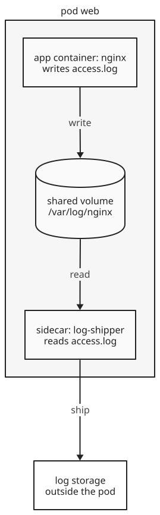

+++
title = 'Sidecar containers'
date = '2026-11-13T18:06:04Z'
+++

A sidecar container is a second container in a  that adds a feature to the main application, such as shipping its logs or encrypting its traffic, without changing the application's code. The containers in one pod run on the same node, share one network namespace, and can share . So a sidecar can read the files the application writes and reach it on `localhost`. The alternative is building the feature into every application, in every language, and updating each one when the feature changes. A sidecar is built once, as its own image, and added to any pod.

A pod with a sidecar has these parts:

- App container: the main application, unchanged.
- Sidecar container: the helper, from its own image, with its own resources and restarts.
- What they share: a volume for files, and the pod's network, so `localhost` reaches both.



## Sidecar, ambassador, and adapter

Brendan Burns and David Oppenheimer of Google described containers working together in one pod in a 2016 paper, and named three patterns. All three put a helper container next to the application. They differ in what the helper does:

- Sidecar: extends the main container. Their example pairs a web server with a container that collects its logs from local disk and streams them to cluster storage.
- Ambassador: proxies the application's connections to the outside. Their example is a twemproxy container: the application talks to one memcache on `localhost`, and the proxy spreads requests across many memcache servers.
- Adapter: presents the application to the outside in a standard form. Their example is a monitoring adapter that turns each application's own metrics format into the one format the monitoring system reads.


In Kubernetes all three are declared the same way, and "sidecar" is the usual name for all of them.

## Common uses

- Log shipping: a log agent, such as Fluent Bit, reads files the application writes to a shared volume and sends them to central storage.
- Service mesh proxy: a proxy such as Envoy handles all the pod's network traffic, adding encryption, retries, and metrics. Istio injects one into each pod as the `istio-proxy` container.
- Database proxy: an ambassador such as Google's Cloud SQL Auth Proxy listens on `localhost`, and the application connects to it as if the database were local. The proxy handles authentication and encryption to the real database.
- File sync: git-sync, a Kubernetes project, pulls a Git repository into a shared volume and keeps it up to date, for a web server or job to read.
- Metrics exporter: an adapter reads an application's own statistics, such as nginx's status page, and serves them in the Prometheus format.

## Declaring a sidecar

Kubernetes declares a sidecar as an init container with `restartPolicy: Always`. An ordinary init container runs to completion before the app starts. With `restartPolicy: Always`, it starts before the app and keeps running for the pod's whole life. This form is stable since Kubernetes 1.33, after first appearing in 1.28.

```yaml
apiVersion: v1
kind: Pod
metadata:
  name: web
spec:
  initContainers:
  - name: log-shipper
    image: busybox:1.36
    restartPolicy: Always
    command: ["sh", "-c", "touch /var/log/nginx/access.log; tail -F /var/log/nginx/access.log"]
    volumeMounts:
    - name: logs
      mountPath: /var/log/nginx
  containers:
  - name: nginx
    image: nginx:1.27
    volumeMounts:
    - name: logs
      mountPath: /var/log/nginx
  volumes:
  - name: logs
    emptyDir: {}
```

Both containers mount the same `emptyDir` volume, an empty directory that lives as long as the pod. The nginx image normally sends its access log to standard output, but the volume mounted over `/var/log/nginx` replaces that, so nginx writes a real file. The sidecar follows that file with `tail -F` and prints each line, standing in for a real log agent.


kubectl apply | Create or update the objects in a file.
-f pod.yaml | The file with the pod above.


`kubectl get pod web` then shows `2/2` ready: the sidecar counts as a container of the pod. A request to nginx from inside the pod appears in the sidecar's output:


kubectl logs | Print a container's standard output.
web | The pod.
-c log-shipper | Which container. A pod with more than one container needs it; without it, kubectl picks the pod's default container.


On a kind cluster, it printed the access log line for that request, `"GET / HTTP/1.1" 200`, which nginx had written to the file.

## Start and stop order

The  starts a pod's sidecars in the order they're listed, and starts the app containers only after each sidecar has started. When the pod is deleted, it stops the app containers first, waits for them to exit, and then stops the sidecars in reverse order. So a log shipper is still running while the app writes its last lines, and a proxy still carries traffic while the app finishes its requests.

A test pod on kind showed this order. Its app container took 5 seconds to shut down after the stop signal, SIGTERM, and each container printed a line at each step:


A sidecar that doesn't exit on SIGTERM is killed when the pod's grace period runs out, 30 seconds by default. A sidecar that exits with a non-zero code during pod termination is normal, and the Kubernetes docs say tools can usually ignore it.

## Before native sidecars

Before 1.28, a sidecar was just a second entry under `containers`. Kubernetes didn't know which container was the helper, which caused two problems:

- No order: all containers started together, so an app could start before its proxy and fail its first connections. On shutdown, the proxy could stop before the app finished its requests.
- Jobs that never finish: a Job's pod completes when all its containers have exited. A log shipper that runs forever keeps the pod running after the real work is done.

Two Jobs on kind show the difference. Both run a container that prints "report done" and exits, beside a log shipper that loops forever:

- Log shipper under `containers`: after the report container exited, the pod showed `NotReady`, and the Job stayed `Running` at `0/1` completions.
- Log shipper as a native sidecar: once the report container exited, the kubelet stopped the sidecar, and the Job reached `Complete`, `1/1`. It took 35 seconds, because the test sidecar ignored SIGTERM and ran until the 30-second grace period ended.

## Service meshes

A service mesh puts a proxy sidecar in every pod and sends all the pod's traffic through it. The application talks plain HTTP to `localhost`. The proxies encrypt traffic between pods with mutual TLS, where both sides prove who they are, and add retries, timeouts, and metrics. A control plane sends each proxy its configuration and certificates.


Istio adds its proxy without changes to the pod spec. Labeling a namespace `istio-injection=enabled` turns on a mutating admission webhook: when a pod is created in that namespace, the  passes it to Istio, which adds the `istio-proxy` container before the pod is stored. Running a proxy in every pod costs memory and CPU in every pod, so Istio also has an ambient mode, generally available since Istio 1.24 in November 2024, that uses one proxy per node instead of one per pod.

## Costs

- Each sidecar is another container in every replica: its CPU and memory requests count toward the pod's, like the app's.
- Each pod pulls one more image and starts one more process before the app can start.
- The sidecar's version is tied to the pod: updating it means restarting the pods that carry it.

References: [Sidecar containers (Kubernetes docs)](https://kubernetes.io/docs/concepts/workloads/pods/sidecar-containers/), [Design Patterns for Container-based Distributed Systems (Burns and Oppenheimer, 2016)](https://www.usenix.org/conference/hotcloud16/workshop-program/presentation/burns), [Istio sidecar injection](https://istio.io/latest/docs/setup/additional-setup/sidecar-injection/), [Istio ambient mode reaches GA](https://istio.io/blog/2024/ambient-reaches-ga/), [git-sync](https://github.com/kubernetes/git-sync), [Cloud SQL Auth Proxy](https://cloud.google.com/sql/docs/postgres/sql-proxy)
