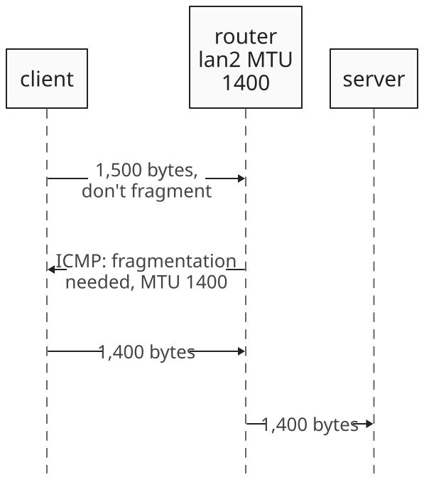

+++
title = 'Addressing and routing'
date = '2026-11-19T04:36:07Z'
+++

The internet layer moves a packet from one host to another across many networks, using IP addresses to name hosts and routing tables to pick each next hop. An IP address has a network part, shared by every host on one link, and a host part. Ports extend an address to one process. On a link, ARP (IPv4) or NDP (IPv6) turns the next hop's IP address into a MAC address. ICMP carries errors and diagnostics, and each router picks the next hop for a packet from its routing table, filled by hand or by routing protocols such as BGP.

Examples come from four Alpine containers on two Docker networks, with a container acting as the router between them:

## IPv4 addresses

- An IPv4 address is 32 bits, written as four decimal bytes: `10.20.1.10`. About 4.3 billion addresses exist, and IANA handed its last free blocks to the regional registries in 2011.
- The prefix length, written `/24`, says how many leading bits are the network ID. The rest are the host ID. `10.20.1.10/24` has network ID `10.20.1.0` and host ID `10`.
- A netmask writes the same thing as an address: `/24` is `255.255.255.0`.
- Two hosts are on the same link when their network IDs match. They exchange frames directly; anything else goes to a router.
- In each network, the all-zeros host ID names the network itself and the all-ones host ID is its broadcast address, so a `/24` holds 254 hosts.

| Range | Use |
|---|---|
| `10.0.0.0/8`, `172.16.0.0/12`, `192.168.0.0/16` | Private networks; not routed on the internet |
| `127.0.0.0/8` | Loopback, the host itself |
| `169.254.0.0/16` | Link-local, self-assigned when no other address is configured |
| `100.64.0.0/10` | Shared address space for carrier NAT |
| `224.0.0.0/4` | Multicast |
| `255.255.255.255` | Broadcast on the local link |

## Subnets

Subnetting moves the boundary between network and host bits to split one network into smaller ones. CIDR (Classless Inter-Domain Routing) allows any prefix length, replacing the old classes A, B, and C, which allowed only `/8`, `/16`, and `/24`. One address, `10.20.1.70`, in three prefix lengths (busybox `ipcalc`):

| Prefix | Netmask | Network | Broadcast | Hosts |
|---|---|---|---|---|
| `/24` | 255.255.255.0 | 10.20.1.0 | 10.20.1.255 | 254 |
| `/26` | 255.255.255.192 | 10.20.1.64 | 10.20.1.127 | 62 |
| `/30` | 255.255.255.252 | 10.20.1.68 | 10.20.1.71 | 2 |

- Each extra prefix bit halves the network: a `/24` splits into two `/25`s, four `/26`s, and so on.
- A network address is the address with its host bits cleared; for `/26`, the last byte rounds down to a multiple of 64.
- Aggregation works the other way: routes for `10.20.1.0/24` and `10.20.2.0/24` can be announced together as `10.20.0.0/22` when all four `/24`s in it go the same way. It keeps routing tables small.

## Ports and socket addresses

- A port is a 16-bit number, 0 to 65535, that names an endpoint inside a host. TCP and UDP each have their own ports.
- A socket address is an IP address and a port: `10.20.2.20:8080`.
- A TCP connection is identified by the protocol and both socket addresses. `ss -tn` on the client showed `10.20.1.10:34443` connected to `10.20.2.20:8080`.
- The server listened on `*:8080`, every address of the host. The client's port, 34443, was picked by the kernel from its temporary range, 32768 to 60999 by default on Linux.
- IANA divides ports into well-known (0–1023, such as 80 and 443), registered (1024–49151), and dynamic (49152–65535).

## Network address translation

 lets many hosts share one public IPv4 address. A router rewrites the source address of outgoing packets, and usually the source port, to its own public address, records the mapping, and rewrites replies back. Hosts behind it use private addresses. A NAT also blocks connections that start from outside unless a mapping exists, such as Docker's `-p 8080:80`. It conserves IPv4 addresses, but breaks the end-to-end model: a host's own address isn't the one the other side sees.

## Delivery: unicast, broadcast, multicast, anycast

- Unicast: one sender to one receiver. Almost all traffic.
- Broadcast: one sender to every host on the link. IPv4 only, and routers don't forward it.
- Multicast: one sender to every host that joined a group, such as `224.0.0.1`, all hosts on the link.
- Anycast: one address announced from several places; routing delivers to the nearest. Public DNS resolvers, such as `1.1.1.1`, use it.

The client pinged the broadcast address `10.20.1.255` and the multicast group `224.0.0.1`. Captures on peer and router showed both arrive, addressed to the MAC `ff:ff:ff:ff:ff:ff` and to `01:00:5e:00:00:01`; a multicast MAC is `01:00:5e` followed by the group's low 23 bits. Neither host answered: Linux ignores echo requests sent to broadcast and multicast addresses by default (`icmp_echo_ignore_broadcasts` is 1), so a single packet can't make every host reply at once.

## From IP to MAC: ARP

A frame on a link is addressed by MAC address, a 48-bit hardware address such as `3e:f6:60:8d:df:99`. Before sending to an IP address on its own link, or to the router for anything else, a host needs that address's MAC. ARP (Address Resolution Protocol) asks for it:

| Frame | From | To | Says |
|---|---|---|---|
| ARP request, 42 bytes | client's MAC | `ff:ff:ff:ff:ff:ff`, every host | `who-has 10.20.1.11 tell 10.20.1.10` |
| ARP reply, 42 bytes | peer's MAC | client's MAC | `10.20.1.11 is-at 86:c3:a4:f7:ed:b7` |

- Every host on the link received the request; only the owner of `10.20.1.11` replied.
- The client stored the answer in its neighbor cache: `ip neigh` was empty before the ping and showed `10.20.1.11 dev eth0 lladdr 86:c3:a4:f7:ed:b7 REACHABLE` after.
- ARP has no authentication. Any host can answer, which is how ARP spoofing redirects traffic on a shared link.
- A MAC address matters only on one link. A router builds a new frame for each hop, with new MAC addresses, while the IP addresses stay the same end to end.

## IPv6 addresses

An IPv6 address is 128 bits, written as eight groups of four hexadecimal digits. Two rules shorten it: drop leading zeros in each group, and replace the longest run of all-zero groups with `::`, once per address.

| Written out | Short form |
|---|---|
| `fd00:0020:0001:0000:0000:0000:0000:0010` | `fd00:20:1::10` |
| `fe80:0000:0000:0000:3cf6:60ff:fe8d:df99` | `fe80::3cf6:60ff:fe8d:df99` |
| `0000:0000:0000:0000:0000:0000:0000:0001` | `::1` |

A network is almost always a `/64`: the first 64 bits are the network ID and the last 64 the interface ID. Address categories, by prefix:

| Prefix | Category | Example in the lab |
|---|---|---|
| `2000::/3` | Global unicast, routed on the internet | none |
| `fc00::/7` | Unique local (ULA), private like `10.0.0.0/8`; `fd00::/8` in practice | `fd00:20:1::10` |
| `fe80::/10` | Link-local, valid on one link only, on every interface | `fe80::3cf6:60ff:fe8d:df99` |
| `ff00::/8` | Multicast; `ff02::1` is all nodes on the link | `ff02::1` |
| `::1/128` | Loopback | `::1` |

- Every IPv6 interface has a link-local address, with or without any other. The client's was built from its MAC `3e:f6:60:8d:df:99`: flip the seventh bit of the first byte (`3e` becomes `3c`) and insert `ff:fe` in the middle. Hosts on real networks often use random interface IDs instead, so the MAC doesn't leak.
- A link-local address needs the interface to be named, such as `fe80::…%eth0`, because every link uses the same prefix.
- IPv6 has no broadcast. Neighbor Discovery (NDP), part of ICMPv6, replaces ARP: the client asked for `fd00:20:1::11` with a neighbor solicitation sent to the solicited-node multicast group `ff02::1:ff00:11`, built from the address's last 24 bits, so only hosts whose addresses end that way process it.
- Unlike IPv4 broadcast, an echo request to `ff02::1` was answered: peer and router both replied, because Linux answers IPv6 multicast echo requests by default.

What IPv6 changes from IPv4:

- Enough addresses for every device to have a global one, so NAT isn't needed.
- A fixed 40-byte header with no checksum, against IPv4's 20 to 60 bytes.
- Routers never fragment; only the sender does, after learning the path MTU.
- Hosts can configure their own addresses from a router's advertised prefix (SLAAC, stateless address autoconfiguration), with no DHCP server.
- Multicast replaces broadcast, so a request bothers only the hosts that might care.

## ICMP

ICMP (Internet Control Message Protocol) carries error reports and diagnostics for IP. Each message has a type and a code, and an error quotes the start of the packet that caused it, so the sender can match it to a connection. ICMPv6 does the same for IPv6 and also carries NDP. Messages the lab produced:

| Message | Type, code | Caused by |
|---|---|---|
| Echo request, echo reply | 8 and 0 | `ping` |
| Time exceeded | 11, 0 | A packet's TTL reached 0 at the router: `ping -t 1 10.20.2.20` |
| Destination unreachable, port unreachable | 3, 3 | A UDP datagram to port 9999 on server, where nothing listened |
| Destination unreachable, fragmentation needed | 3, 4 | A 1,500-byte packet that mustn't be fragmented, for a link with an MTU of 1,400 |

- TTL (time to live; hop limit in IPv6) is decremented by each router, and a packet reaching 0 is dropped. Replies from server had TTL 63, not 64: one router on the way.
- `traceroute` sends packets with TTL 1, 2, 3, and so on, and lists who returns each "time exceeded". It showed `10.20.1.254`, then `10.20.2.20`.
- Path MTU discovery: senders set "don't fragment", and a router with a smaller next link returns "fragmentation needed" with its MTU instead of forwarding. With the router's lan2  set to 1,400:

- The first `ping -M do -s 1472` got `Frag needed and DF set (mtu = 1400)` from `10.20.1.254`. The kernel cached the result: `ip route get 10.20.2.20` then showed `mtu 1400` for about 10 minutes, the next large ping failed locally with `Message too large`, and a 1,400-byte one went through.
- A firewall that drops all ICMP breaks this. Large packets then vanish silently, and connections hang after the handshake, a failure called a PMTU black hole.

## Routing

A host or router sends each packet by its routing table: a list of prefixes, each with a next hop or a directly attached link. The most specific matching prefix wins, called longest prefix match. The client's table, with one extra route added for the test:

| Route | Meaning |
|---|---|
| `default via 10.20.1.1` | Anything else goes to Docker's gateway |
| `10.20.0.0/16 via 10.20.1.1` | Added for the test |
| `10.20.1.0/24 dev eth0` | lan1 is attached directly: send frames straight to the host |
| `10.20.2.0/24 via 10.20.1.254` | lan2 is behind router |

`ip route get` showed the choice for each destination:

| Destination | Matching prefixes | Chosen |
|---|---|---|
| `10.20.1.11` | `/0`, `/16`, `/24` on eth0 | Direct, on eth0 |
| `10.20.2.99` | `/0`, `/16`, `/24` via router | `via 10.20.1.254` |
| `10.20.9.9` | `/0`, `/16` | `via 10.20.1.1`, from the `/16` |
| `1.1.1.1` | `/0` only | `via 10.20.1.1`, the default route |

- The router forwards packets because IP forwarding is on (`net.ipv4.ip_forward=1`); a host with it off drops packets not addressed to it.
- Server needed its own route back, `10.20.1.0/24 via 10.20.2.254`. Each direction is routed separately, and the return path can differ.
- Routing protocols fill tables automatically and react to failures. Inside one organization, interior gateway protocols such as OSPF and IS-IS find shortest paths across its routers.
- Between organizations, BGP (Border Gateway Protocol) connects autonomous systems (AS), networks under one routing policy, each with a number. A BGP router tells its neighbors which prefixes it can reach and the list of ASes on the way, the AS path. Each AS picks routes by its own policy and business relationships, not by shortest distance. The internet's global routing table is the result of tens of thousands of ASes exchanging BGP routes.

## In a program

Go's `net/netip` package parses and compares addresses: `netip.ParsePrefix("10.20.1.70/26")` gives a prefix, `.Masked()` gives the network `10.20.1.64/26`, `.Contains(addr)` tests membership, and `.Is4()`, `.IsPrivate()`, `.IsLinkLocalUnicast()`, and `.IsMulticast()` name the address's category. `net.JoinHostPort` writes socket addresses, adding brackets for IPv6, as in `[fd00:20:1::10]:8080`. A link-local address needs its zone, `fe80::…%eth0`, to be dialed. `net.Interfaces` lists the host's interfaces with their MAC addresses and MTUs, and `Addrs` lists each one's addresses. The kernel does ARP, NDP, routing, and path MTU discovery; a program only sees their results, such as an `EMSGSIZE` error for a datagram larger than the path MTU. [Networking basics]() covers the layers these sit in.

References: [RFC 791: Internet Protocol](https://www.rfc-editor.org/rfc/rfc791), [RFC 4632: CIDR](https://www.rfc-editor.org/rfc/rfc4632), [RFC 1918: Private address space](https://www.rfc-editor.org/rfc/rfc1918), [RFC 6890: Special-purpose IP address registries](https://www.rfc-editor.org/rfc/rfc6890), [RFC 6335: Port number procedures](https://www.rfc-editor.org/rfc/rfc6335), [RFC 3022: Traditional NAT](https://www.rfc-editor.org/rfc/rfc3022), [RFC 1112: IP multicast](https://www.rfc-editor.org/rfc/rfc1112), [RFC 826: ARP](https://www.rfc-editor.org/rfc/rfc826), [RFC 8200: IPv6](https://www.rfc-editor.org/rfc/rfc8200), [RFC 4291: IPv6 addressing architecture](https://www.rfc-editor.org/rfc/rfc4291), [RFC 5952: IPv6 address text representation](https://www.rfc-editor.org/rfc/rfc5952), [RFC 4193: Unique local IPv6 addresses](https://www.rfc-editor.org/rfc/rfc4193), [RFC 4861: Neighbor Discovery](https://www.rfc-editor.org/rfc/rfc4861), [RFC 4862: SLAAC](https://www.rfc-editor.org/rfc/rfc4862), [RFC 7217: Stable private interface IDs](https://www.rfc-editor.org/rfc/rfc7217), [RFC 792: ICMP](https://www.rfc-editor.org/rfc/rfc792), [RFC 4443: ICMPv6](https://www.rfc-editor.org/rfc/rfc4443), [RFC 1191: Path MTU discovery](https://www.rfc-editor.org/rfc/rfc1191), [RFC 4271: BGP-4](https://www.rfc-editor.org/rfc/rfc4271), [Linux IP sysctl](https://docs.kernel.org/networking/ip-sysctl.html), [Go net/netip](https://pkg.go.dev/net/netip)
