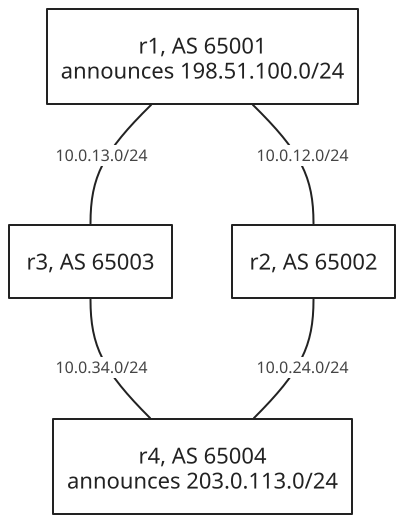
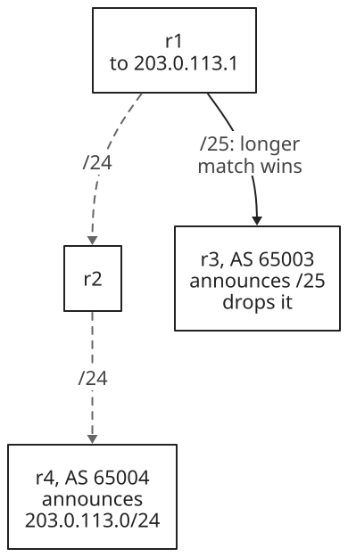

+++
title = 'BGP'
date = '2026-11-21T05:21:07Z'
+++

BGP (Border Gateway Protocol) is the routing protocol that networks run between each other to tell which address prefixes each can reach. The internet is tens of thousands of autonomous systems (AS), networks under one routing policy such as an ISP, a cloud, or a university, each with an AS number. Inside an AS, routers can share one view of the network and pick shortest paths. Between ASes, no one sees the whole graph and each network has its own business interests, so BGP carries reachability plus the list of ASes on the way, and every AS chooses routes by its own policy.

BGP has these parts:

- Sessions: two routers, called peers or neighbors, hold a TCP connection on port 179. eBGP runs between ASes; iBGP runs inside one.
- Routes: a prefix, such as `203.0.113.0/24`, with path attributes. The AS path lists the ASes a route passed through; the next hop is the address to forward to.
- Best-path selection: each router keeps every route it hears for a prefix and picks one, by a fixed list of checks.
- Policy: route maps and filters on each session decide which routes come in, which go out, and with what changes.

The lab is four FRR 10.4 routers in Docker containers, one per AS, linked in a square by four Docker networks. The AS numbers are private ones, and the two announced prefixes are documentation ranges. Each router's default route was removed, so it could reach only directly linked networks and what BGP taught it. A dummy interface on r1 holds `198.51.100.1`, and one on r4 holds `203.0.113.1`.

## Sessions

- A session is one TCP connection. Both peers may connect at once; in the lab, r1 and r2 opened connections to each other 13 µs apart. Each side sends an OPEN, and the connection started by the router with the higher BGP identifier, r2's, survived. The other closed with a NOTIFICATION, Cease: connection collision resolution.
- Every BGP message starts with a 19-byte header: a 16-byte marker of all ones, a length, and a type.

| Message | Bytes in the lab | What it carries |
|---|---|---|
| OPEN | 99 | Version 4, the AS number, a hold time of 180 s, the BGP identifier, and capabilities |
| UPDATE | 52–60 | Withdrawn prefixes, path attributes, and the prefixes they apply to |
| KEEPALIVE | 19 | Just the header: the peer is alive |
| NOTIFICATION | 21–23 | An error code; the session ends after it |

- r1's OPEN offered capabilities: IPv4 unicast routes, route refresh, 4-byte AS numbers, extended messages over 4,096 bytes, extra paths per prefix, its host name `r1`, and graceful restart.
- The hold time is how long a peer waits for any message before it declares the session dead. Each side sends a KEEPALIVE every third of it, 60 s in FRR's default.
- Before any route moved, FRR showed each session's routes as `(Policy)` and logged `Inbound updates discarded due to missing policy`. RFC 8212 says an eBGP session exchanges no routes until a policy is configured in each direction. FRR follows it by default, outside its datacenter defaults. A route map that permits everything was enough.

## Updates

After the OPENs, each side sends its routes as UPDATEs. In the capture, after r1 cleared and re-formed its session with r2, r2 sent:

| AS path | Next hop | Prefix |
|---|---|---|
| 65002 65004 65003 65001 | 10.0.12.22 | `198.51.100.0/24` |
| 65002 65004 | 10.0.12.22 | `203.0.113.0/24` |
| none | none | none: End-of-RIB |
| 65002 65001 | 10.0.12.22 | `198.51.100.0/24`, 50 ms later |

- Each AS adds its own number to the front of the AS path as it passes a route on, and sets the next hop to its own address on the link.
- The first route reached r2 around the square while the r1–r2 session was down. r1 saw its own AS, 65001, in the path and discarded the route. This check is how BGP avoids loops between ASes.
- An empty UPDATE marks End-of-RIB: the peer has sent every route it has.
- A new route for the same prefix replaces the old one; no separate withdrawal is sent. A withdrawal lists prefixes in its withdrawn routes field.
- A router sends only its best route for each prefix, unless both peers support sending extra paths. r2 knew one path for each prefix, though the square has two: r4's best route to `198.51.100.0/24` went through r2 itself, and r2 would discard a path that already holds 65002.
- FRR installs each best route in the kernel's routing table: on r1, `203.0.113.0/24 via 10.0.12.22 dev eth0 proto bgp metric 20`. Packets then follow the table, as with any route.

## Best path

FRR compares routes for one prefix in a fixed order and stops at the first difference. The main checks, in order:

1. Weight, a setting local to one router.
2. Local preference: higher wins. It is set by the receiving AS's own policy.
3. AS path length: shorter wins.
4. Origin, then MED, then eBGP over iBGP, then the cost to reach the next hop inside the AS.
5. For two eBGP routes, the one already selected, which is the older one.
6. The lowest router ID, then the lowest peer address.

r1 heard two routes to `203.0.113.0/24`:

| Setup | r1's choice | FRR's reason |
|---|---|---|
| No policy | 65002 65004, received first | Older Path |
| r4 prepends 65004 twice toward r3 | 65002 65004, over 65003 65004 65004 65004 | AS Path |
| r1 sets local preference 200 on routes from r3 | 65003 65004 65004 65004 | Local Pref |

- Local preference decides where an AS's own traffic leaves. It beat the shorter path, so prepending is only a request to other ASes: any of them can override it.
- Prepending decides nothing locally; it makes one way into an AS look longer to others. Real paths do this: a RIPE route collector in Montevideo heard `1.1.1.0/24` with the path `46997 38008 38008 13335`.
- Paths are chosen separately in each direction. With r4 prepending toward r3, r1's traffic to `203.0.113.1` went through r2, and the replies came back through r3. Traceroute from r1 showed only the forward way.

## Policy and leaks

Policy is set per session, in each direction, with route maps that match routes and change their attributes. Networks connect as customers, which pay their providers for transit, or as peers, which exchange each other's customer traffic without charge, and policy follows the money: an AS announces everything to its customers, but only its own and its customers' routes to its providers and peers.

- With permit-all policies, r1 passed r2's route to `203.0.113.0/24` on to r3, and r3 held the path `65001 65002 65004`. r1 offered to carry traffic between its two providers. RFC 7908 calls this a route leak.
- One outbound filter on r1 fixed it. An AS path access list with the regular expression `^$` matches only routes with an empty path, the ones r1 originated itself, and a route map applied it to both sessions. r3's alternative path then disappeared.


bgp as-path access-list OWN seq 5 permit ^$ | Match routes with an empty AS path: this AS's own routes.
route-map OUT permit 10 | Create a route map, OUT; routes that don't match are denied.
match as-path OWN | Permit only routes the access list matches.
neighbor 10.0.13.33 route-map OUT out | Apply it to routes sent to r3.


## Failures

r1 pinged `203.0.113.1` every 100 to 200 ms while the link between r2 and r4 failed in two ways:

| Failure | Outage | What ended the session |
|---|---|---|
| Interface down at both ends | 0.3 s | r2 saw the link go down, dropped the session at once, and withdrew the route. Two pings got `Destination Net Unreachable` from r2. |
| Link up, every packet dropped by `tc netem` | 162 s | Nothing reported a fault. r2 waited for the hold time, then sent `Hold Timer Expired`. |

- The hold time counts from the last message received. Keepalives come every 60 s, so a silent failure lasts between 120 and 180 s with these timers.
- r1 then switched to the path through r3, `65003 65004 65004 65004`, which it had held all along.
- Shorter timers, or BFD, a separate protocol that sends small hello packets many times a second, detect a silent failure sooner.

## Hijacks

BGP itself trusts what peers announce. In the lab, r3 announced `203.0.113.0/25`, half of r4's prefix, and discarded the traffic with a blackhole route.

- r1 and r2 installed both routes, and longest prefix match sent `203.0.113.1` to r3: 100% loss. `203.0.113.200`, outside the /25, still reached r4 through r2.
- On 24 February 2008, Pakistan Telecom (AS17557) announced `208.65.153.0/24`, inside YouTube's `208.65.152.0/22`. Its provider passed it on, and YouTube's traffic went to Pakistan for about two hours.
- A prefix-list on r1 that accepts only prefixes of /24 or shorter (`permit 0.0.0.0/0 le 24`) removed the /25, and pings worked again.
- r3 then announced the whole `203.0.113.0/24` as its own. Its path, `65003`, was shorter than `65002 65004`, so r1 chose it and pings failed again. Prefix length can't catch this one.

RPKI (Resource Public Key Infrastructure) lets an address holder sign a ROA (route origin authorization): which AS may originate a prefix, and up to what length. Routers get the validated ROAs from a cache over the RPKI-to-Router protocol and mark each route valid, invalid, or not found.

- The lab ran StayRTR as the cache, with a ROA for `203.0.113.0/24`: max length 24, AS 65004. r1 marked r3's route `I` and the real one `V`. A route-map entry `match rpki invalid` with `deny` dropped it, and pings worked.
- Real ROAs: `1.1.1.0/24` has a ROA for AS 13335, max length 24, and RIPE's collectors saw that origin from 222 of 223 peers.
- Origin validation checks only the last AS in the path. When r3 put 65004 at the end of its own announcement, the path `65003 65004` was valid and as short as the real one; it lost only on the older-path tie-break. ASPA, RPKI records listing each AS's providers, lets a router check every hop of the path.

## Inside an AS

- iBGP carries external routes between an AS's own routers. A router doesn't pass a route learned over iBGP to another iBGP peer, since the AS path doesn't change inside an AS and can't catch loops there. So every iBGP router peers with every other, or with route reflectors that are allowed to pass routes on.
- An IGP, such as OSPF or IS-IS, finds paths inside the AS, including to the next hops BGP routes point at.
- The global table that a full BGP router holds had 1,093,129 IPv4 prefixes on 15 November 2026, as seen by the CIDR Report.

## In Kubernetes

- Calico can run BGP on every node to announce pod addresses, so the network routes pods without an overlay. By default, all nodes use AS 64512 and form an iBGP full mesh; Calico's docs suggest route reflectors past about 100 nodes, or peering with top-of-rack routers.
- MetalLB in BGP mode has each node peer with the network's routers and announce the IPs of `LoadBalancer` Services. Routers that support multipath spread traffic across the nodes; when a node is removed, the router's hash can move existing connections to other nodes.

## In a program

A program never speaks BGP to reach a server. BGP fills the kernel's routing table, and `net.Dial` in Go, or any socket call, sends packets that follow it. What a program meets is BGP's results: an outage of seconds to minutes while routes converge, during which connections hang or fail with errors such as `network is unreachable`, and paths that differ in each direction. Programs that do speak BGP, such as route servers and Kubernetes load balancers, use implementations like FRR or GoBGP, a BGP daemon and library in Go. [Addressing and routing]() covers routing tables and longest prefix match, and [NAT]() the other rewriting that happens between networks.

References: [RFC 4271: BGP-4](https://www.rfc-editor.org/rfc/rfc4271), [RFC 6793: Four-octet AS numbers](https://www.rfc-editor.org/rfc/rfc6793), [RFC 4724: Graceful restart and End-of-RIB](https://www.rfc-editor.org/rfc/rfc4724), [RFC 8654: Extended messages](https://www.rfc-editor.org/rfc/rfc8654), [RFC 8212: Default eBGP route propagation](https://www.rfc-editor.org/rfc/rfc8212), [RFC 7908: Route leaks](https://www.rfc-editor.org/rfc/rfc7908), [RFC 4456: Route reflection](https://www.rfc-editor.org/rfc/rfc4456), [RFC 5880: BFD](https://www.rfc-editor.org/rfc/rfc5880), [RFC 6480: RPKI](https://www.rfc-editor.org/rfc/rfc6480), [RFC 6811: Origin validation](https://www.rfc-editor.org/rfc/rfc6811), [RFC 8210: RPKI-to-Router protocol](https://www.rfc-editor.org/rfc/rfc8210), [RFC 6996: Private AS numbers](https://www.rfc-editor.org/rfc/rfc6996), [RFC 5737: Documentation address blocks](https://www.rfc-editor.org/rfc/rfc5737), [FRR BGP documentation](https://docs.frrouting.org/en/latest/bgp.html), [YouTube hijacking: a RIPE NCC RIS case study](https://www.ripe.net/about-us/news/youtube-hijacking-a-ripe-ncc-ris-case-study/), [RIPEstat](https://stat.ripe.net/), [CIDR Report](https://www.cidr-report.org/as2.0/), [Calico: Configure BGP peering](https://docs.tigera.io/calico/latest/networking/configuring/bgp), [MetalLB in BGP mode](https://metallb.io/concepts/bgp/), [GoBGP](https://github.com/osrg/gobgp)
