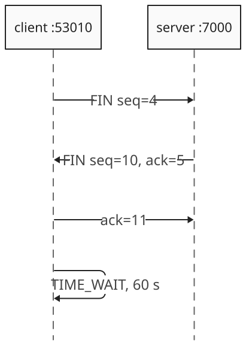

+++
title = 'TCP'
date = '2026-11-22T00:03:07Z'
+++

TCP (Transmission Control Protocol) turns IP's separate, unreliable packets into a reliable, ordered stream of bytes between two processes. IP may lose, duplicate, delay, or reorder packets, and it says nothing when it does. TCP numbers every byte it sends, and the receiver acknowledges what has arrived, so the sender can resend what was lost and the receiver can put bytes back in order. The alternative, UDP, sends each datagram once and leaves loss and order to the application.

TCP has these parts:

- Connection: state on both hosts, named by protocol, source address and port, and destination address and port. A three-way handshake creates it.
- Sequence numbers: every byte has one. Each segment carries the number of its first byte.
- Acknowledgments: the receiver reports the next byte it expects, so one ACK confirms everything before it.
- Retransmission: the sender resends a segment that no ACK covers, after a timer or after hints from later ACKs.
- Flow control: the receiver advertises a window, the free space in its receive buffer, and the sender never sends beyond it.
- Congestion control: the sender also limits itself to a congestion window, which it grows while ACKs arrive and cuts when packets are lost.
- Close: each side sends a FIN when it has nothing more to send. An RST ends a connection at once.

The lab is two Alpine containers, `client` at `10.30.0.10` and `server` at `10.30.0.20`, on Linux 6.12. Each delays its outgoing packets by 25 ms with `tc netem`, for a round trip of 50 ms, and has segmentation offload turned off so captures show packets as they are on the wire. Small Python programs opened, used, and closed connections, `tcpdump` captured them on the client, and `iptables` rules on the server dropped chosen packets. `strace` recorded the system calls of a Python client and of a Go client and server.

## The kernel and the program

TCP runs in the operating system's kernel, not in the program. A process holds a socket, a file descriptor that names a connection's state inside the kernel, and uses it only through system calls. The kernel sends and answers every packet: handshakes, ACKs, retransmissions, window updates, probes, and the close. It does this on its own timers, whether the process is running, blocked, stopped, or gone.

A blocking Python client, traced with `strace`:

| System call | What the kernel did | Returned after |
|---|---|---|
| `socket()` | Created a socket, file descriptor 3 | 30 µs |
| `connect()` | Picked a source port, sent the SYN, and waited for the SYN-ACK | 54.6 ms, one round trip |
| `send(b"hi")` | Copied 2 bytes into the send buffer; TCP sent them later | 41 µs |
| `recv()` | Slept until the reply was in the receive buffer, then copied it out | 54.6 ms |
| `close()` | Released the descriptor; the kernel sent the FIN | 41 µs |

- A system call moves bytes between the process and a buffer. `send()` returning means the kernel has the bytes, not that the peer does. A `sendall()` of 1 MB returned about 365 ms after the SYN; the last data left at 415 ms, and the last ACK arrived at 440 ms.
- The kernel picks a client's source port from `ip_local_port_range`, 32768 to 60999 in the lab, which gives about 28,000 connections to each server address and port.
- The first connection to a new address took 109 ms instead of 53: before sending the SYN, the kernel resolved the server's hardware address with ARP, another round trip.
- When a process ends, the kernel closes its descriptors as `close()` would, and TIME_WAIT then lives in the kernel with no process behind it.

Go puts every socket in non-blocking mode and waits in `epoll`, which reports readiness for many sockets at once:

- `socket()` was called with `SOCK_NONBLOCK`. `connect()` returned `EINPROGRESS` after 60 µs, while the kernel continued the handshake.
- The runtime registered the socket with `epoll_ctl` and waited in `epoll_pwait`, which returned after 50.5 ms with the socket writable. `getsockopt(SO_ERROR)` returned 0, so the connection had succeeded.
- `read()` returned `EAGAIN`, since nothing had arrived; `epoll_pwait` woke 53.7 ms later, and the next `read()` got `HELLO hi`.
- On the server, `listen(4, 4096)` asked for a backlog of `somaxconn`, and `accept4()` took a connection the kernel had already completed. The client's `hi` was already in the connection's receive buffer, so the first `read()` returned it at once.
- Right after connecting, Go set `TCP_NODELAY` and the keepalive options: `SO_KEEPALIVE`, `TCP_KEEPIDLE` 15, `TCP_KEEPINTVL` 15, and `TCP_KEEPCNT` 9.

The kernel also decides how bytes become segments and how much it buffers:

- Nagle's algorithm holds a small write while earlier data is unacknowledged. Five 10-byte writes, 5 ms apart, went as one segment of 10 bytes and, 50 ms later when the ACK came, one of 40. With `TCP_NODELAY`, they went as five segments, 5 ms apart. Python leaves Nagle on, and Go turns it off.
- The kernel grows each connection's buffers as a transfer goes on. During 10 MB, the server's receive buffer grew from 131,072 bytes to 6,291,456, the maximum in `tcp_rmem`, and the client's send buffer from 46,080 to 4,194,304, the maximum in `tcp_wmem`.
- A program that sets `SO_RCVBUF` fixes the buffer instead. A server that asked for 65,536 bytes got 131,072, since the kernel doubles the value for its own overhead, and kept it. The window stayed small, and 10 MB took 6.4 and 6.6 s instead of 0.84 and 0.89 s.
- With segmentation offload on, TCP hands the device segments of up to 20,272 bytes, 14 full segments' worth, and they are cut to full-sized packets later: by a network card in hardware, or by the kernel just before the driver. `tcpdump`, which sees packets before the card does, counted 144 data packets for 1 MB instead of 691. Between two containers, nothing cut them: the server's capture showed the same sizes. The lab's other captures turned offload off.

The lab's kernel settings:

| Setting | Value | Controls |
|---|---|---|
| `net.ipv4.ip_local_port_range` | 32768 60999 | Source ports for outgoing connections |
| `net.ipv4.tcp_rmem` | 4096 131072 6291456 | Receive buffer: minimum, initial, maximum |
| `net.ipv4.tcp_wmem` | 4096 16384 4194304 | Send buffer: minimum, initial, maximum |
| `net.core.somaxconn` | 4096 | Largest backlog a `listen()` can ask for |
| `net.ipv4.tcp_congestion_control` | cubic | Congestion control for new connections |
| `RLIMIT_NOFILE` | 1,048,576 | Open file descriptors per process, sockets included |

## The handshake

- The client's SYN carries its initial sequence number (ISN), `2551007285`. The server's SYN-ACK carries its own, `2648549757`, and acknowledges the client's plus one. A SYN and a FIN each use up one sequence number, though they carry no data.
- Each side picks its ISN from a clock and a keyed hash of the connection's addresses and ports, so an attacker off the path can't guess it, and a new connection on the same ports starts far from an old one's numbers.
- Options exist only in the SYN and SYN-ACK. MSS 1460 is the largest segment each side accepts: a 1,500-byte MTU minus 20 bytes of IP and 20 of TCP header. SACK permitted allows selective acknowledgments. Window scale 7 multiplies every later window by 128. Timestamps put the sender's clock in every segment, for measuring round trips.
- `connect()` returned after 55.7 ms, one round trip. The reply to the 3-byte request arrived at 106.4 ms, a second round trip.
- The server's kernel answered the SYN and completed the handshake; the program's `accept()` only took the finished connection.

What the client's `connect()` saw, depending on the server:

| Server | Packets back | `connect()` |
|---|---|---|
| Listening | SYN-ACK | Connected after 55.7 ms |
| No process on the port | RST | `Connection refused` after 55 ms |
| Firewall rejects with ICMP | ICMP host unreachable | `Host is unreachable` after 53 ms |
| First SYN lost | SYN-ACK to the retransmitted SYN | Connected after 1,087 ms |
| Firewall drops | none | `Operation timed out` after 134.4 s |

- A lost SYN costs a full second: the first retransmission timeout is 1 s, because nothing is known yet about the round trip.
- Against the dropping firewall, the client sent 11 SYNs, at 0, 1, 2, 3, 4, 5, 7, 11, 19.7, 36.1, and 68.4 s. Linux spaces the first five retries 1 s apart (`tcp_syn_linear_timeouts` is 4), then doubles. `tcp_syn_retries` is 6, which the kernel's docs translate to a last SYN at 67 s and a timeout at 131 s.

## The accept queue

The kernel finishes handshakes on its own and keeps the finished connections in the accept queue until the program calls `accept()`. A server called `listen(1)` and never accepted, and four clients connected 200 ms apart:

| Client | Handshake | Result |
|---|---|---|
| 1 and 2 | Completed in 54–58 ms | Connected. The server's kernel ACKed their 2 bytes of data, and `recv` timed out after 20 s, since no process ever read. |
| 3 and 4 | SYNs dropped silently | Retransmitted SYNs for 20 s, then `connect` timed out |

- The queue held backlog plus one, two connections. `ss -lt` showed `Recv-Q 2` and `Send-Q 1` on the listening socket: queued connections and the backlog.
- Further SYNs were dropped, not refused, so a full server looks like a firewall that drops packets. The counter `TcpExtListenOverflows` reached 6.
- `net.core.somaxconn`, 4,096 in the lab, caps the backlog a program can ask for.

## Sequence numbers and ACKs

- A segment's sequence number is the number of its first byte; its length says how many follow. An ACK names the next byte the receiver expects, so `ack=4` confirms bytes 1 to 3.
- ACKs are cumulative. If one ACK is lost, the next one covers its bytes.
- 1,000,000 bytes went as 691 segments: 690 of 1,448 bytes and one of 880. Each segment's 1,460 bytes of room lost 12 to the timestamp option.
- The receiver sent about 110 packets back for 691 segments. At first it ACKed every segment; later one ACK often covered several.

The sender may have more segments in flight than its congestion window allows. It starts with 10 segments (about 14 KB) and, in slow start, adds one segment per ACK, which doubles the window every round trip:

| Round trip | Segments sent |
|---|---|
| 1 | 10 |
| 2 | 20 |
| 3 | 40 |
| 4 | 80 |
| 5 | 160 |
| 6 | 320 |
| 7 | 61, the rest |

The whole 1 MB took 432 ms, about 8 round trips, and was acknowledged by 404 ms after the SYN. On a new connection, round trips, not bandwidth, limited it.

## Loss and retransmission

The sender finds a lost segment in one of two ways:

- Retransmission timeout (RTO): the sender keeps a timer from its measured round-trip time, the smoothed RTT plus four times its variation, at least 200 ms on Linux. When the 3-byte request was dropped, the client resent it 257 ms later, and the reply came at 363 ms instead of 106.
- Duplicate ACKs and SACK: when a later segment arrives, the receiver ACKs again with the same number and a SACK block listing the bytes it did get. The sender resends the hole without waiting for the timer.

When one data segment of the 1 MB transfer was dropped 160 ms in:

- The server sent duplicate ACKs, all `ack=41993`, with SACK blocks growing from `43441–44889` to `43441–63713` as later segments arrived.
- The client resent the 1,448 bytes at `41993` 30 ms after the first duplicate ACK arrived.
- The congestion window was cut, and slow start ended. CUBIC, Linux's default congestion control, then grew the window slowly, so the transfer finished at 1,236 ms instead of 404.

With 2% of the data segments dropped at random, three runs of the same 1 MB took 1.65, 0.82, and 3.24 s. The cost of loss depends on where it falls: early in slow start, or near the end, where no later segments arrive to trigger duplicate ACKs and only the timer remains.

## Flow control

The window in every segment is the free space in the sender's receive buffer, multiplied by the window scale. A server accepted a connection and never read from it, while the client wrote as fast as it could without blocking:

- The server's advertised window fell from 76,800 bytes to 0 in 0.74 s, as its receive buffer filled with 121,888 bytes.
- The client's `send()` accepted 396,752 bytes in 0.24 s and then would block. The other 274,864 bytes waited in the client's send buffer.
- With a zero window, the client sent window probes: empty segments with a sequence number already acknowledged, which the receiver must answer with an ACK showing its current window. They went at 1.04, 1.66, 2.81, 5.05, 9.66, 18.9, and 36.8 s, doubling apart.
- The connection doesn't time out while the probes are answered. A program that stops reading stalls its peer's writes indefinitely.

## Closing

- Each side's FIN says it will send no more data; the other side's `read` then returns end of file. Closing takes four messages, a FIN and an ACK each way. Here the server's ACK rode on its own FIN, so three packets went.
- The side that sends the first FIN enters TIME_WAIT. Right after close, `ss` showed the client's socket with a timer of 59 s. Meanwhile the same addresses and ports can't start a new connection, so stray segments from the old one can't be taken as new data, and a lost final ACK can be sent again.
- A half-close sends a FIN in one direction only. The client called `shutdown(SHUT_WR)` after its request, the server read to end of file, then sent `got it` back and closed.

Many sockets in CLOSE_WAIT mean the program read end of file and never closed them. Many in TIME_WAIT mean the host closes many short connections first.

## Resets

An RST says the connection is gone, and nothing is acknowledged or retransmitted after it:

| What happened | Packets | What the peer saw |
|---|---|---|
| Server closed with received data still unread | RST, not FIN | `recv`: `Connection reset by peer` |
| Server set `SO_LINGER` to 0 and closed | RST | `Connection reset by peer`; no TIME_WAIT |
| Server process killed with `kill -9` | FIN, sent by the kernel | `recv` returned end of file |
| Server process killed with 100 bytes unread | RST | `Connection reset by peer` |
| Client wrote twice after the server closed | The first write went out and drew an RST | First write succeeded; the second failed with `Broken pipe` |

- A killed process doesn't leave its connections open: the kernel closes its sockets as `close()` would. A crash looks like a clean close to the peer unless data was unread.
- A write only copies bytes into the send buffer, so a write can succeed and the error come with a later call.

## Dead peers

When a host loses power or its network, it sends nothing, neither FIN nor RST. In the lab, the server's firewall dropped every packet of an open connection in both directions:

| Client's situation | Detected | Error |
|---|---|---|
| Idle, no keepalive | Never: still ESTABLISHED after 17 minutes | none |
| Keepalive after 5 s idle, probes every 2 s, 3 probes | 11.2 s after the last traffic: probes at 5.1, 7.1, and 9.2 s, then an RST | `Operation timed out` |
| Wrote 100 bytes | 997.6 s after the write, about 16.6 minutes, after 15 retransmissions 0.26, 0.26, 0.58, 1.1, 2.1, and 4.6 s apart, then doubling up to 120 s | `Operation timed out` |
| Wrote 100 bytes with `TCP_USER_TIMEOUT` of 10 s | 10.6 s after the write | `Operation timed out` |

- An idle connection sends nothing, so it can't notice anything. Keepalive sends an empty segment with an old sequence number after an idle time; a live peer must ACK it. Linux's default idle time, `tcp_keepalive_time`, is 2 hours.
- Unacknowledged data is retransmitted with a doubling timeout. `tcp_retries2`, 15 by default, gives a timeout of at least 924.6 s; the connection ends at the first retransmission timeout past it, here at 997.6 s.
- In both write cases, `send()` returned at once; the error came from the following `recv()`.

## In a program

In Go, `net.Dial` and `net.Listen` hand the handshake, retransmission, and windows to the kernel, and its errors surface as the same conditions:

- `net.Dialer.Timeout` defaults to none, so a dial to a host behind a dropping firewall waits for the kernel's 131 s or more. A `Timeout` or a context deadline ends it sooner.
- Every connection has `TCP_NODELAY` set, so small writes go out at once. `TCPConn.SetNoDelay(false)` restores Nagle's algorithm.
- Dialed and accepted connections send keepalives by default: 15 s idle, probes every 15 s, 9 probes, so a dead peer on an idle connection is found after about 150 s. `KeepAliveConfig` changes them.
- `conn.SetDeadline` bounds a blocked read or write. `TCP_USER_TIMEOUT` has no field of its own and is set through `Dialer.Control`.
- Errors wrap the system ones: `syscall.ECONNREFUSED`, `ECONNRESET`, `ETIMEDOUT`, and `EPIPE` for a broken pipe, which Go returns as an error instead of letting `SIGPIPE` end the process, except on standard output and error.
- `Read` returns `io.EOF` when the peer's FIN arrives. `TCPConn.CloseWrite` sends a FIN for a half-close, and `SetLinger(0)` makes `Close` send an RST.
- `net.Listen` asks for a backlog of `net.core.somaxconn`.

[Networking basics]() covers headers, MSS, and how round trips limit transfers, and [TLS]() what runs on top of a TCP connection.

References: [RFC 9293: Transmission Control Protocol](https://www.rfc-editor.org/rfc/rfc9293), [RFC 6528: Defending against sequence number attacks](https://www.rfc-editor.org/rfc/rfc6528), [RFC 7323: TCP extensions for high performance](https://www.rfc-editor.org/rfc/rfc7323), [RFC 2018: Selective acknowledgment](https://www.rfc-editor.org/rfc/rfc2018), [RFC 6298: Computing the retransmission timer](https://www.rfc-editor.org/rfc/rfc6298), [RFC 6928: Increasing the initial window](https://www.rfc-editor.org/rfc/rfc6928), [RFC 5681: TCP congestion control](https://www.rfc-editor.org/rfc/rfc5681), [RFC 9438: CUBIC](https://www.rfc-editor.org/rfc/rfc9438), [RFC 1122: Requirements for internet hosts, keep-alives](https://www.rfc-editor.org/rfc/rfc1122#section-4.2.3.6), [RFC 5482: TCP user timeout option](https://www.rfc-editor.org/rfc/rfc5482), [RFC 896: Congestion control in IP/TCP, Nagle's algorithm](https://www.rfc-editor.org/rfc/rfc896), [tcp(7)](https://man7.org/linux/man-pages/man7/tcp.7.html), [socket(7)](https://man7.org/linux/man-pages/man7/socket.7.html), [epoll(7)](https://man7.org/linux/man-pages/man7/epoll.7.html), [connect(2)](https://man7.org/linux/man-pages/man2/connect.2.html), [listen(2)](https://man7.org/linux/man-pages/man2/listen.2.html), [Linux IP sysctl](https://docs.kernel.org/networking/ip-sysctl.html), [Linux segmentation offloads](https://docs.kernel.org/networking/segmentation-offloads.html), [ss(8)](https://man7.org/linux/man-pages/man8/ss.8.html), [strace(1)](https://man7.org/linux/man-pages/man1/strace.1.html), [tc-netem(8)](https://man7.org/linux/man-pages/man8/tc-netem.8.html), [Go net package](https://pkg.go.dev/net), [Go os/signal, SIGPIPE](https://pkg.go.dev/os/signal#hdr-SIGPIPE)
